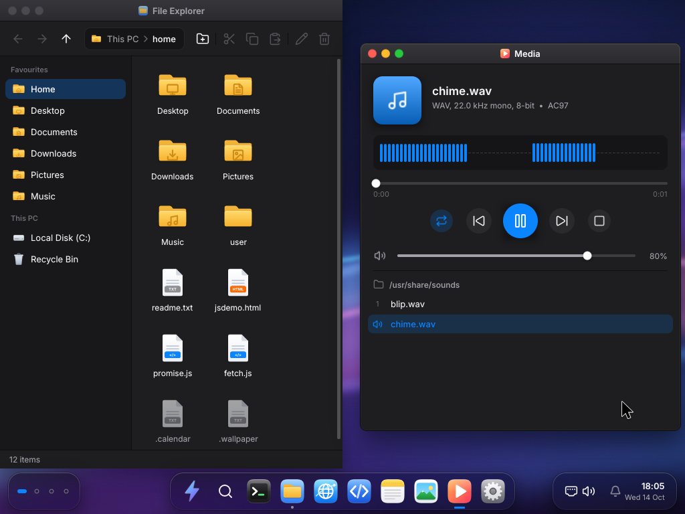

# BoltOS

A 64-bit operating system written from scratch in C and x86-64 assembly — no
GRUB, no Multiboot, no external libraries. Custom boot chain (legacy BIOS MBR +
UEFI), own kernel.

**Using it:** [GUIDE.md](GUIDE.md) — install, daily use, troubleshooting, and an
honest account of what it cannot do yet.
**Writing software on it:** [DEVELOPING.md](DEVELOPING.md), with
[SDK.md](SDK.md) for the syscall ABI and [SHELL.md](SHELL.md) for the shell.
**What is left:** [ROADMAP.md](ROADMAP.md).

> Status: **active development.** Custom boot chain (stage1 → stage2 → long mode,
> or UEFI → long mode) into a 64-bit C kernel. UEFI boot, ACPI, APIC, **SMP
> (symmetric multiprocessing)**, HPET, a framebuffer compositor and windowed
> **GUI desktop with 35 apps** (including a playable port of **DOOM**), a
> preemptive **round-robin scheduler** with processes and **ring-3 userland**
> (ELF64 loader + syscalls), physical and virtual memory management (including
> **ASLR, SMAP, SMEP** and **swap**), a **persistent filesystem** on real ATA /
> NVMe / AHCI SATA disks (HDD/SSD) behind a VFS and generic block layer, **EXT2
> and FAT32** standard filesystem support, hardware interrupts, keyboard and
> mouse drivers, an **xHCI USB** host-controller driver with **HID** support,
> **Intel HDA + AC97 audio** drivers, an interactive shell, a dual-stack
> **IPv4 + IPv6 TCP/UDP/TLS 1.2+1.3 network stack** (Neighbour Discovery and
> SLAAC, X.509 certificate verification, **DHCP**, persistent configuration, a
> DNS cache and an **SNTP** clock)
> on **e1000** and **virtio-net** NICs, a **standards-ish web browser** with a real DOM tree, CSS
> cascade, box/flex/grid layout engine and a from-scratch **JavaScript
> interpreter**, a **multi-language IDE** with from-scratch **C / C++ / C#
> compilers** and a **Python interpreter**, a **GPU / display-adapter driver**,
> support for running real **Windows PE32+ executables**, **Intel HDA + AC97 +
> PC-speaker audio**, **TrueType font** rendering, a **system-wide clipboard**, **stack
> canary** protection, **multi-user** support, a **package manager** with a real
> package/repository format that installs over HTTP, **local version control**,
> **core dumps** with symbolised backtraces, a full
> **freestanding libc**, **BSD-style sockets** reaching ring 3, an **SSH server**,
> and image decoding.

## Image Preview



*A screenshot of the BoltOS desktop showing the windowed GUI, taskbar, and desktop launcher icons.*

## Desktop & apps

The GUI (`kernel/gui.c`) is a compositing window manager: every window draws into
a backbuffer through vector helpers (`g_fill`, `g_round`, `g_text`, `gui_icon`, …),
which is flipped to the framebuffer. Windows support move/resize, focus/z-order,
minimize/maximize, a taskbar with pinning, right-click context menus, and a
desktop of double-clickable launcher icons. Font rendering uses **TrueType**
outlines (`kernel/ttf.c`) in addition to the built-in bitmap fonts. A
system-wide clipboard (`kernel/clipboard.c`) carries text, an image or a
list of files -- one item, typed, so every reader asks what kind it is before
taking it.
Each app is a `kernel/app_*.c` file exposing `draw/key/click/drag/tick` callbacks.

### Clipboard

One item, of one of three kinds. Text is a static buffer, because copying a
selection must not be able to fail. An image is on the heap, because a full
screen is three megabytes. Files are carried as their paths, which means a
file selection is also text -- paste it into Notes and you get the paths, paste
it into File Explorer and you get the files, and neither app has to know about
the other representation.

Ctrl+C in Photos or Paint copies the picture; Ctrl+V in Paint pastes one,
scaled to fit rather than cropped. Pasting an image into a folder in **File
Explorer** writes it out as a PNG, through the same encoder screenshots use.
Copying a file in File Explorer publishes its path, so it can be pasted into a
Terminal. `clip show` says which kind is loaded rather than pretending
everything is text.

### Keyboard shortcuts

Every global shortcut is a row in a table (`kernel/keymap.c`), not a line of
code. Alt+Tab used to be a synthetic byte invented inside the keyboard driver,
Win+D an `if` in the compositor, and Ctrl+Alt+L a special case in the middle of
the Ctrl-key handler; all of them worked and none could be changed. The driver
now resolves a chord against the table *before* deciding what a key means, so a
bound shortcut never reaches a window, and the compositor is handed an action
rather than a keycode.

`keys` lists them, `keys lock Ctrl+Alt+K` rebinds one, `keys ACTION none`
unbinds, `keys reset` restores. Chords are modifiers joined by `+` and one key
(`Ctrl+Alt+F2`, `Win+Shift+Left`, `F9`). A bare character is refused -- binding
`k` alone would take that letter away from every program -- and two actions
cannot share a chord. Changes are kept in `/etc/keys.conf` and reloaded at boot;
a line that will not parse is reported and skipped rather than costing you a
keyboard. Lock and screenshot outrank a modal dialog; the window-management ones
do not.

### The Start menu

Press Win and type. The app grid filters as the characters arrive, and from the
second character the query also goes to the filesystem: the signed-in user's
home directory first, because that is where a person's own files are, then the
rest of the tree, skipping anything whose name starts with a dot and anything
the current account may not read. Five results, because a menu that lists a
thousand files is not a menu -- `find` is where the complete answer lives.

Enter opens the first match, an app if one matched and otherwise the first file.
A file opens in the program its extension belongs to, through the same
`files_launch()` the File Explorer's double-click uses, so there is one
association table rather than two that drift apart. Results are held as paths
rather than `fs_node` pointers: the menu can sit open while something else
deletes the file, and a stale node would be a dangling pointer into freed heap
the moment somebody clicked it.

The search only runs when the query changes, not once per frame -- it walks the
tree, and the desktop repaints a great deal more often than anybody types.

### Window tiling

Halves, quarters and maximise. Drag a title bar to the top edge to maximise, to
a side to take that half, or to a side near the top or bottom for the quarter in
that corner -- the landing zone is drawn under the window while you hold the
button, so you can see where it will go before you let go. Win+arrow does the
same from the keyboard and *walks*: Win+Left gives the left half, Win+Up from
there the top-left quarter, Win+Down the half below it again, and Win+Left out
of a right-hand zone puts the window back where it was floating.

One function computes the rectangle for every zone, which is why the preview and
the placement agree -- they were two expressions of `W / 2` for a while and they
disagreed by a pixel on an odd width. `snap ZONE` is the shell front end, for a
session over SSH and for a test that would otherwise be testing the keyboard
driver.

### Virtual desktops

Four of them. A window belongs to the desktop it was opened on, and from the
others it is not merely unpainted -- it is out of the taskbar, out of Alt+Tab,
and out of every hit test, so nothing you click or type can reach a window you
cannot see. Closed-but-pinned taskbar launchers are shortcuts rather than
windows, so they appear on all four.

Win+1..4 switches, Ctrl+Alt+Left/Right walks, Win+Shift+Left/Right
takes the focused window with you (following it, because throwing a window
somewhere you cannot see is not a feature), and the pips at the left of the
taskbar do the same with the mouse -- lit where there are windows, wide where
you are. `desk`, `desk N` and `desk move N` are the shell front end, for the
Terminal and for a session over SSH.

### Screenshots

Print Screen (F12) or `screenshot [PATH]` captures the screen to a PNG in
the signed-in user's `Pictures`, and opens it in Photos. It reads the panel
back rather than the compositor's backbuffer, so DOOM, the ring-3 browser and
the plain text console capture correctly too -- and it works in safe mode and
over SSH, where there is no desktop to press a key in.

The PNG writer (`kernel/png_enc.c`) is real: 8-bit truecolour, per-row None/Sub
filter selection, LZ77 over a 32 KiB window and fixed-Huffman deflate in a zlib
stream. A 1024x768 desktop frame comes out around 20 KB against 2.3 MB for the
uncompressed BMP this replaces. `test/host/png.c` compiles the encoder on the
host and `test/t_shot.py` decodes its output with Python's own zlib, asserting
exact pixels on flat, gradient, noise, 1x1 and images longer than the window --
an encoder only ever read back by its own decoder can be wrong in matching
pairs and nobody finds out.

### Logs

`dmesg` shows this boot's kernel ring, which lives in RAM. `/var/log/kernel.log`
is what survived earlier boots, and `logs` reads it back.

Neither half of that used to be true. `klog_persist()` existed but the only
caller was `dmesg save`, so the log survived a reboot exactly when somebody had
thought to ask for it in advance -- which is not when anybody needs it. A clean
shutdown now writes it before the final commit, trimmed to stay under a size
cap, and `logs` can read it. `logs -n N` and `logs -a` control how much, and
`logs save` writes the current ring immediately: the boot that ends badly is
otherwise exactly the boot whose log is lost.

The Logs app shows all three side by side -- this boot's ring (live, and
saveable with a button), earlier boots, and the crash log -- coloured by the
kernel's own `[ok]`/`[--]` tags so a page of it can be skimmed.

### Notifications

`kernel/notify.c` is a kernel-wide store of what the machine has to say, and the
desktop is one reader of it. A notification is a stacked toast bottom-right for
about three seconds *and* a row in the tray's notification centre afterwards,
so something that finishes while you are looking at another window is still there
when you look back. The bell carries an unread badge; rows show level, source and
time, scroll, and can be read, dismissed one at a time, or cleared.

The store is a fixed ring in `.bss` with no allocation, which matters because the
things most worth saying -- a failed commit, a disk gone read-only, a crash --
happen when allocation is a bad bet. Anything in the kernel can post
(`notify_post`, or `notify_error`/`notify_warn`/…) without knowing whether a GUI
exists; the compositor registers a hook and draws what is there. Every
notification is mirrored into the kernel log, so `dmesg`, the serial console and
a headless test see them too. `gui_toast()` still works and is now the
plain-information case.

From the shell, `notify` posts (`notify -l error -s Disk "the disk is full"`) and
reads (`notify list -a`, `notify read`, `notify dismiss ID`, `notify clear`) --
a machine administered over SSH has no taskbar. Today the ring-3 crash path posts
where the core dump is, and the storage layer posts when a disk has been
protected read-only and changes are RAM-only.

Bundled apps (34):

- Terminal — the full interactive shell in a window
- File Explorer — browse/open the persistent filesystem
- Browser — a layout-engine web browser (DOM + CSS cascade + box/flex/grid +
  JavaScript) over the kernel's own HTTP/HTTPS stack
- OldBrowser — a NetSurf port: the NetSurf core architecture (nsurl,
  content cache, handler pipeline, `browser_window` + back/forward history) with
  its classic framebuffer-frontend toolbar (Back / Forward / Reload / Stop /
  Home, address bar, throbber, bookmarks), rendering through the BoltOS layout
  engine over the kernel TCP/TLS stack
- Code — a multi-language IDE (C / C++ / C# / Python) with a project
  tree, open-file tabs, syntax highlighting, line numbers, a Run button
  that builds the project's target (`build.txt`) and an output console
- Task Manager — live process / CPU / memory view
- Settings — themes and system options (persisted), font switching
- Install BoltOS — the graphical installer: pick a disk, create the account,
  watch the progress bar; writes both the legacy and UEFI boot paths
- Software — the package manager with a window on it: what the repository
  offers and what is installed, one click to install or remove, over the same
  index parser and install path `pkg` uses
- Security — session and lock settings, the firewall (rules, presets, live
  pass/block counters) and the account list
- Logs — this boot's kernel ring, what survived earlier boots, and the
  crash log, in one scrollable window
- Media — a WAV player: the folder a track came from is the playlist, the
  level meter is drawn from the samples on their way to the codec, and playback
  is fed from the compositor's main loop rather than the window's tick, so it
  keeps playing while the window is minimised, on another desktop, or while the
  session is locked
- Calculator, Clock, Stopwatch, Calendar, Notes (saved to FS)
- Paint, Color Picker, Piano (PC-speaker, zoomable multi-octave)
- System Info, Matrix rain
- Games: DOOM (real doomgeneric port, playable E1M1), Minesweeper,
  Snake, 2048, Tic-Tac-Toe, Memory match, Conway's Game of Life

> The kernel logic is fixed-point / integer math, but **SSE is enabled and the
> FPU/SSE register file is saved and restored across context switches**: the
> scheduler gives every thread its own 512-byte `FXSAVE` area and the ISR common
> path (`kernel/isr.asm`) `fxsave`s the outgoing thread and `fxrstor`s the
> incoming one around every interrupt, so XMM/x87 state never leaks between
> threads. Ring-3 programs (e.g. the libc `libm`) can use floating point freely.

## Userland (ring 3, ELF64)

BoltOS runs real user programs in **ring 3**. `user/` is a tiny freestanding C
program (`crt0.asm` + `ulibc.c`) linked to a static ELF64 (`user/user.ld`)
and embedded into the kernel image at build time. The kernel's ELF loader
(`kernel/elf.c`) maps the segments into a fresh address space; the program
traps into the kernel via `syscall` (`kernel/syscall.asm` + `syscall.c`) for I/O.
A preemptive round-robin scheduler (`kernel/sched.c`) with per-process
state (`kernel/proc.c`) time-slices processes off the PIT. Userland benefits
from ASLR (randomised load base), SMAP/SMEP (kernel/user page isolation),
and per-process address spaces.

### Ring-3 browser & JS

The web browser, DOM/layout engine and JavaScript interpreter run in ring 3,
not in the kernel. `kernel/{dom,layout,js}.c` — the HTML tokeniser + DOM tree
builder, the CSS cascade + box/flex/grid layout engine, and the BoltJS
interpreter — are the *same sources* the kernel uses, but they are also compiled
into two userland ELF programs and executed in ring 3:

- `/bin/js` (`user/js_main.c`) — the JavaScript interpreter as a ring-3
  program. `js FILE.js` execs it; the language runtime never touches kernel mode.
- `/bin/browser` (`user/browser_main.c`) — the web browser as a ring-3
  program. It loads a page (local file, or a URL through the kernel network
  stack), builds the DOM, runs the CSS cascade + layout, executes the
  page's JavaScript (with a real DOM-bound `js_host`, including `fetch()`),
  and paints the box tree to the framebuffer — all in ring 3. Launch it with
  the `webx [url]` shell command; keys scroll / follow links (Tab+Enter) / edit
  the address bar (`g`) / quit (`q`).

The kernel exposes only the privileged primitives behind four syscalls
(`include/syscall.h`): `SYS_FBINFO` maps the framebuffer into the process and
pauses the compositor (a `g_fb_exclusive` flag the GUI loop checks), `SYS_GETKEY`
reads the keyboard, `SYS_HTTPGET` fetches a URL over the in-kernel TCP/TLS stack,
and `SYS_FBEND` hands the screen back. No HTML parsing, layout, or script
execution happens in ring 0. (The in-window desktop Browser app still uses
the in-kernel copy of the engine for its embedded window.)

### Preemptible syscalls

Syscalls run with interrupts enabled. `SYSCALL` enters with IF cleared by
FMASK, and every wait in the network stack has the same shape — spin
`netif_poll_all()`, then `hlt` until the next timer tick, until the deadline
passes. With interrupts off that tick never arrives: the `hlt` never wakes, the
deadline is never reached, and the machine stops dead rather than timing out.
That is why no ring-3 program could use the network at all; `SYS_HTTPGET` had
the same defect from the start, so the ring-3 browser froze the machine the
moment it fetched anything.

Enabling interrupts means a syscall can be preempted, which the user RSP was
not ready for: it was stashed in a global, so two threads in syscalls at once
would overwrite each other's and return to ring 3 on the wrong stack. It is
pushed on the process's kernel stack instead, one copy per invocation (with a
matching padding push, so the frame stays 16-byte aligned for the C ABI). The
global survives only as a scratch slot across the stack switch itself, where IF
is still clear.

### Program arguments

`proc_exec_vec()` passes a full argv vector (`PROC_MAX_ARGV` entries). The
loader could previously hand a program argv[0] plus at most one operand, so no
ring-3 program could take an option and an argument at the same time —
`netget HOST PATH PORT` silently ran as `netget HOST` and used defaults for the
rest, which presents as the network being broken rather than as a missing
argument.

### SDK and third-party executables

[SDK.md](SDK.md) documents the static ELF64 format, syscall ABI version 1,
public headers and ring-3 C runtime. `sdk/build.sh -o myapp main.c util.c`
builds an external program with the host toolchain. Download it, set its mode
with `chmod 755`, then use `run /path/to/myapp [args...]` (or `run myapp` for
`/bin/myapp`). The shell reports the exit status and exposes it as `$?`.
Malformed ELF headers, out-of-bounds segments and kernel-address destinations
are rejected before loading; failed loads release their allocated pages.
`cc -N` compiles BoltCC's integer subset to a native ELF64 through the
assembler, on the machine itself; full self-hosting remains unfinished.

## ACPI / APIC / SMP

**ACPI** (`kernel/acpi.c`) discovers the RSDP, RSDT/XSDT, and MADT, and provides
table-checksum validation — the foundation for APIC, HPET, and SMP boot.

APIC (`kernel/apic.c`) reprograms the local APIC and I/O APIC, replacing the
legacy PIC for interrupt routing. Each CPU core gets its own local APIC timer.

SMP (`kernel/smp.c` + `kernel/ap_boot.asm` + `kernel/hpet.c`) brings up
application processors: the BSP writes the trampoline to low memory, sends an
IPI, and each AP runs its own idle loop. The HPET provides a cross-core
synchronised time base. The CPU count is reported in `sysinfo`.

## UEFI boot

`boot/uefi_boot.c` is a **UEFI boot loader** (BOOTX64.EFI) that boots BoltOS on
modern firmware with no CSM/legacy BIOS. It reproduces the environment the
kernel expects from the legacy stage2: loads the kernel at 0x100000, sets up
long-mode page tables (identity + higher-half direct map), and passes a
`bootinfo` struct (GOP framebuffer + memory map) in RDI. Built with
`clang --target=x86_64-unknown-windows` (MS ABI) and linked as an EFI
application.

## Installer

BoltOS installs itself. `install` (shell) and the **Install BoltOS** desktop app
are two front-ends over `kernel/install.c`, and they write a self-contained,
bootable system onto a target disk from inside a running BoltOS — no host
toolchain, no `dd`, no second machine.

Both boot paths are laid down, so the result boots on legacy BIOS *and* on UEFI
firmware:

```
LBA 0        stage1 (MBR), with the partition table overlaid on its code
LBA 1..32    stage2
LBA 33       BoltOS boot header — where the kernel is and how big it is
LBA 34..     kernel.bin
partition 1  FAT32 EFI system partition: EFI/BOOT/BOOTX64.EFI + kernel.bin
partition 2  BoltFS, seeded with a copy of the running filesystem
```

The trick that makes this possible is that a running BoltOS **carries its own
bootloader**: `build.sh` embeds `stage1.bin`, `stage2.bin` and `BOOTX64.EFI` into
the kernel image as blobs. That in turn only works because stage2 no longer has
the kernel's size assembled into it — it reads the boot header at LBA 33 instead
(see *Boot flow*). The one piece that cannot be embedded is `kernel.bin` itself
(a kernel cannot contain a copy of itself), so it is read back from the medium
this machine booted from: the boot header on the install disk, or `kernel.bin` on
the ESP under UEFI.

The wizard asks for the target disk and the username/password of the account
you will sign in with, shows the exact layout it is about to write, and then
reports progress. If the target happens to be the disk this live system is
persisting to — the normal case when installing from a single-disk live medium —
persistence is detached first and the in-RAM tree is what gets copied over.

```
install                              list the installable disks and the planned layout
install DISK                         interactive: asks for the account, confirms, installs
install DISK USER PASS [ESP_MB]      unattended
```

`test/t_install.py` installs onto a blank 512 MiB disk, throws the install medium
away, and boots the result on both legacy BIOS and UEFI.

## Storage (HDD / SSD / NVMe / AHCI SATA) + VFS

Storage sits behind a **generic block layer** (`kernel/blk.c` + `include/blk.h`):
a small registry of `blkdev_t` transports plus shared MBR-partition helpers, so
the filesystem doesn't care whether a disk is ATA, AHCI, or NVMe.

An ATA/IDE PIO block driver (`drivers/ata.c`) probes the legacy ATA register
file on both channels (ports `0x1F0/0x3F6` and `0x170/0x376`), runs `IDENTIFY` on
each slot, and supports LBA28/LBA48 sector read/write. The same command set drives
both spinning HDDs and SSDs; the two are told apart from IDENTIFY word 217
(nominal media rotation rate: `1` = non-rotating = SSD). ATAPI/CD-ROM slots are
detected and skipped.

An NVMe driver (`drivers/nvme.c`) brings up a controller over PCI/MMIO: it
sets up the admin queue pair, runs `IDENTIFY`, creates one I/O queue pair, and
registers namespace 1 with the block layer. Completions arrive on a **hardware
MSI/MSI-X interrupt** (`pci_msi_enable` routes a vector to the local APIC, the
I/O completion queue is created with IEN=1): the issuing thread `hlt`s until the
interrupt wakes it instead of busy-polling the CQ phase bit. If the controller
exposes no MSI capability the driver falls back to polling so it still works
everywhere.

An AHCI (SATA) driver (`drivers/ahci.c`) drives Serial ATA host bus adapters
over DMA. Each port gets a command list, received FIS area, and command table;
one command runs at a time out of slot 0. Polled completions keep the code
synchronous.

The native filesystem (BoltFS, `fs/ramfs.c`) is reached through a VFS layer
(`kernel/vfs.c`). `fs_persist_init()` prefers the installed boot disk's BoltFS
partition, then existing BoltFS on data disks (NVMe, SSD, HDD), and **loads a
saved image on boot**. Existing data takes priority over a faster empty disk.
For the small scratch disks shipped by `build.sh`, first boot may initialise a
wholly zero-filled disk of at most 64 MiB; every sector is read before that
decision. Larger or unknown disks require the installer. Foreign partitions,
GPT/hybrid tables, overlapping partitions and unreadable disks are not adopted.
Autosave commits the whole tree on every mutation. `diskinfo` lists disks and
whether writes are persistent or confined to RAM;
`sync` forces a commit. QEMU exposes data disks (`run.sh`) across both transports.

A failed image load never triggers formatting. The loader builds a detached
tree and replaces the live tree only after every record and allocation succeeds.
If no copy can load, the original disk is protected read-only and the seed tree
remains available in RAM. `fsck` diagnoses it; `sync` and `fsck -r` cannot replace
the unreadable image with seed files. For protected or volatile storage, File
Explorer warns that changes will not be saved to disk, and System Info identifies
protected storage.
See [STORAGE_UPGRADE.md](STORAGE_UPGRADE.md)
for the recovery behavior, tests and remaining storage limitations.

### Crash safety: atomic commits, flush barriers, fsck

BoltFS uses atomic commits with device cache-flush barriers.
The partition holds two blob slots and a mirrored superblock, and a commit is
a shadow-page swap: serialise the tree into the slot that is *not* live, write
it, flush the device's write cache, then swap the superblock generation (and
mirror it). Whatever instant the power fails, the next mount finds a complete
image — the previous one or the new one, never a torn mix — and a torn primary
superblock simply fails its FNV-1a checksum and falls back to the mirror. This is
the guarantee a write-ahead log provides; the whole-image rewrite already *is*
the redo record, so no separate log is needed.

The flush barrier is real hardware, not a no-op: `blkdev_t` gained a `flush` op
implemented as ATA/AHCI FLUSH CACHE EXT and the NVMe Flush command, so a
disk that acknowledges writes out of its DRAM cannot reorder the blob past the
superblock that names it.

The superblock carries a clean flag, cleared on mount and set only by
`fs_shutdown()`. Finding it clear means the last run ended badly, and the mount
runs a consistency check automatically (the boot menu's entry 4 forces one on
demand). `fsck` runs the same check from the shell — both superblocks, the blob
checksum, and the record chain (parents precede children, sizes stay inside the
blob, names terminate) — and `fsck -r` rewrites the image from the live tree.

`poweroff` and `reboot` commit the filesystem and mark it clean *before* touching
ACPI, so an ordinary shutdown never costs the next boot a check. Older v1 images
are migrated into the opposite half of the partition before their old records
are overwritten. Images too large for that migration remain read-only.

If a write or flush fails during a BoltFS commit, further commits are disabled
until reboot. A failed flush may still have persisted the primary superblock;
retrying against the previous slot number could overwrite the image it now
names. `diskinfo` reports this protected state and `sync` refuses to claim
success. Allocation failures before disk I/O leave the previous image intact
and can be retried after memory is freed.

FAT32 overwrites use safer ordering: `fat32_write` used to free the old
cluster chain and delete the directory entry *first*, so a crash mid-write
destroyed the file outright. It now writes the new data to freshly allocated
clusters while the old copy is still intact, switches the directory entry over in
a single sector write, and only then releases the old chain — and that switch
really is one sector. Publishing a file used to read the whole cluster the entry
lives in, change 32 bytes and write all of it back, putting up to 1023 unrelated
files through the drive to change four fields in one of them.

Every FAT read can now fail. `fat_get()` reported a failed FAT read as an end of
chain, which is indistinguishable from a real one: a read error in the middle of
a file truncated it and still returned success, and freeing a chain stopped
halfway. Chain walks, directory walks, `fat32_read`, `fat32_list` and
`fat32_write` all report I/O errors as errors, a chain that ends before the
length in its directory entry is a failure rather than a short file, and a write
that cannot read the parent directory refuses rather than concluding the file is
absent and filing a second entry for it. `test/host/fat.c` runs the real driver
against a disk that fails reads, fails writes, tears sectors and loses power;
`test/t_fat.py` runs it and then writes to the actual volume and reboots.

FAT32 still does not have BoltFS's mirrored commit protocol. Startup never treats
a failed FAT32 mount as permission to format an unknown disk, and recovery mode
blocks FAT32 formatting, writes and directory creation.

### Standard filesystems (EXT2 / FAT32)

Beyond BoltFS, the kernel can mount EXT2 (`fs/ext2.c`) and FAT32
(`fs/fat32.c`) volumes — read/write for FAT32, read-only for EXT2. Both go
through the generic block layer and VFS, so standard disk images from Linux or
Windows are accessible from the shell and File Explorer.

## Audio (Intel HDA + AC97)

Two codec drivers sit behind one interface (`include/audio.h`), and
`drivers/audio.c` picks between them at boot: **Intel HD Audio** first, then
AC'97, then the legacy PC speaker (`drivers/pcspk.c`) so a tone always
makes a sound. Everything above the line — Media, Music, Piano, DOOM, `play` — speaks
only 48 kHz / 16-bit / stereo PCM and never learns which codec it reached.

Intel HD Audio (`drivers/hda.c`) is what a machine built since about 2005
actually has. Bringing it up means two separate jobs. The controller side is a
PCI device with MMIO registers, DMA stream engines and a command/response ring
pair (CORB/RIRB, with the immediate-command registers as a fallback for
controllers that implement only one of the two well). The codec side is a graph
of widgets that arrives with *nothing connected*: the driver walks it, scores the
output pins from their configuration defaults, traces a route from the best pin
back to a converter through any mixers and selectors in the way, selects that
branch at every fork, unmutes each amplifier along it and switches the pin's
output driver on. Volume is a real gain control on that route, not a software
scale. Playback is polled; because an HDA stream buffer is cyclic, each buffer is
submitted as the caller's PCM followed by a block of silence, so a buffer that
drains before the caller notices plays quiet rather than repeating itself.

AC'97 (`drivers/ac97.c`) drives the Intel ICH controller over PCI for older
boards and QEMU's `-device AC97`: PCM-out programmed through a buffer descriptor
list on the bus-mastering engine, same 48 kHz stereo contract.

WAV playback (`kernel/wav.c`) is the decoder *and* the converter, because
the two cannot be separated: the codecs are fixed at 48 kHz stereo and almost no
file on a disk is. It parses RIFF/WAVE (PCM and `WAVE_FORMAT_EXTENSIBLE`, 8- or
16-bit, any rate, any channel count), then resamples with a 16.16 fixed-point
linear interpolator, expands mono to stereo and converts 8-bit WAV's *unsigned*
samples to signed — get that last one wrong and silence plays as full-scale
noise. Decoding is incremental, so `play FILE` streams a track a quarter-second
at a time instead of converting it in full before the first sample is heard. The
system sounds are generated at build time by `mkwav.py` and seeded to
`/usr/share/sounds` in two deliberately different shapes (22 kHz mono 8-bit,
44.1 kHz stereo 16-bit), so between them they exercise every conversion.

The Media player (`kernel/app_media.c`) is what makes that usable. `play`
holds the calling thread until the last sample is gone, which is fine for a test
and no good for music; the player decodes half a second at a time and is fed
from `media_pump()` at the top of the compositor's main loop. That placement is
the design: the loop wakes on every timer interrupt, so the handover from one
buffer to the next costs about a millisecond rather than the 150 ms a window
tick would, and being above every early-out in that loop, a track keeps playing
while its window is minimised, while another desktop is showing, while the
session is locked and while a ring-3 program owns the panel. The folder a track
came out of is its playlist and it advances on its own; the level meter is
measured from the PCM on its way to the device, so a silent passage shows
silence. `media` is the same transport from a prompt — `media open FILE`,
`play`/`pause`, `next`, `seek`, `vol` — for scripts and for a session over SSH,
and opening the player that way deliberately does not take the keyboard away
from the shell you typed into. There is one codec and one stream: Media and
Music stop each other, and a blocking `play` preempts both through a hook
`drivers/audio.c` calls before it submits — the alternative is two callers
pushing buffers at one DMA engine and both coming out broken.

`test/t_audio.py` and `test/t_wav.py` point QEMU's audio backend at a WAV file
and assert on the samples that actually left the guest — how many there were and
what frequency they carry — so a wrong sample rate, a wrong stream format, a
muted amplifier or a subtly wrong resampler fails the test even though every
register reads back correctly. `test/t_media.py` uses the same capture to
check the thing the player exists for: nothing is typed for six seconds, and the
audio arriving at the sound card over the whole run is far more than the system
sounds hold, at both of their pitches — so it was fed continuously, by something
other than the shell, across the end of a track.

## Web browser & network stack

The windowed **Browser** is no longer an HTML flattener — it is a small but real
rendering engine. A page is parsed into a DOM tree (`kernel/dom.c`): a proper
tokenizer + tree builder with implicit-close rules, void/self-close/raw-text
handling, and a selector engine (type/`.class`/`#id`/universal, compound
selectors, descendant and child combinators, selector lists) backing
`querySelector` / `querySelectorAll` plus DOM mutations.

On top of the tree sits a CSS cascade + layout engine (`kernel/layout.c`):

- Cascade — `#hex` / `rgb()` / `rgba()` / `hsl()` / `hsla()` / named /
  `transparent` colors, selector specificity (a,b,c) + source order,
  property inheritance, intrinsic tag defaults, and inline `style=""`.
- Layout — the box model (margin / padding / border / width → border-box),
  block + inline flow with text word-wrap on the bitmap-font grid,
  flexbox (row/column, `flex-grow`, `gap`, `justify-content`, `align-items`)
  and CSS grid (px + `fr` tracks, `repeat()`, gaps, row wrapping).

This box tree is what the Browser actually paints — backgrounds, borders, wrapped
text, images, inputs and hit-tested links — relaid out on width change
(responsive). The NetSurf libcss library (`vendor/libcss-0.9.2/`) and
libhubbub HTML parser (`netsurf/libhubbub/`) are also compiled in,
supporting the OldBrowser port and the `nstest` validation command.

A from-scratch JavaScript interpreter (`kernel/js.c`, "BoltJS") runs page
scripts: lexer → recursive-descent (precedence-climbing) parser → AST walker.
Numbers are int64 (no FPU). It is wired to the real DOM:
`document.querySelector`, `createElement`, `appendChild`, `setAttribute` /
`getAttribute`, element `id` / `className` / `href` / `value`, `document.cookie`,
and `localStorage` / `sessionStorage`; mutations trigger reflow. A persistent VM
lives for the page's lifetime, so it also has an event loop:
`addEventListener` with click dispatch, `setTimeout` / `setInterval` /
`requestAnimationFrame` (driven off the PIT tick), and **`fetch()` returning real
Promises** (`.then` / `.catch` / `.finally`, `Promise.resolve` / `reject` / `all`,
`new Promise`) drained through a microtask queue, plus `JSON.parse` / `stringify`.
The `js` shell command runs code inline (`js -c "…"`, in-kernel for quick eval)
or a script file (`js FILE.js`), which executes in ring 3 via the userland
interpreter `/bin/js` (see *Ring-3 browser & JS* below).

Pages load over the kernel's own stack (DNS → TCP → TLS → HTTP/1.1):

- `http://` and `https://` with cookies, redirects, keep-alive, and gzip /
  deflate content-encoding (`net/inflate.c`). DHCP (`net/dhcp.c`) auto-
  configures the network interface on boot (IP, gateway, DNS). HTTPS uses an
  in-kernel TLS 1.2 *and* 1.3 client (`net/tls.c` + `net/crypto.c`): ECDHE
  over X25519 / secp256r1 (P-256), AES-128-GCM-SHA256 and
  AES-256-GCM-SHA384. The server certificate chain is now verified
  (`net/x509.c` + `net/rsa.c` + `net/p256.c` / `net/p384.c`): RSA PKCS#1 v1.5 /
  PSS and ECDSA P-256 signatures, hostname and validity dates, against a small
  runtime trust-anchor store — so it resists an active MITM, not just passive
  eavesdropping.
- local HTML files from the filesystem (e.g. the bundled `/web/index.html`).

Click links to navigate, type a URL in the address bar, `<` goes back, and the
scrollbar / Space / `b` / `j` / `k` scroll. The data path rides an e1000 or
virtio-net NIC over QEMU/VirtualBox NAT, with a from-scratch stack:
ARP, IPv4, ICMP, UDP, TCP, DNS, HTTP, a firewall (`net/firewall.c`), and TLS
(`net/*.c`). Wi-Fi is real — scan, WPA2-PSK, CCMP, DHCP over the air; see
**802.11** below for what the radio underneath it is. The shell also has
`browse URL` (render a page as text), `download URL` (save to the FS), and
`nstest` (exercise NetSurf libraries).

### Adapters: e1000 and virtio-net

The e1000 is what QEMU offers by default, but virtio-net (`drivers/virtio_net.c`)
is what almost everything else offers — it is the default on KVM/libvirt, Proxmox,
VirtualBox's virtio adapter and every mainstream cloud hypervisor. Without it
BoltOS has no network at all on most machines anyone would actually run it on.

The driver speaks the legacy VIRTIO 0.9.5 PCI transport deliberately: a
handful of I/O ports rather than the modern capability-walking BAR layout, which
QEMU still presents by default and which is the same virtqueue model underneath
— the smallest amount of code that reaches the most hypervisors. It sets up the
receive and transmit virtqueues in one contiguous DMA allocation, reads the MAC
from the device configuration, and takes completions on a PCI interrupt.
`test/t_net.py` boots the same system on both adapters and expects a DHCP lease
on each.

### IPv6: an address nobody handed out

`net/ip6.c`, `net/nd6.c` and `net/icmp6.c` add IPv6 addressing, Neighbour
Discovery and SLAAC. At boot the interface forms a link-local address from
its own MAC as a modified EUI-64, checks with Duplicate Address Detection
that nobody else has it, solicits a router, and builds a global address out
of whatever prefix comes back, with no server involved anywhere — that's the
whole idea behind stateless autoconfiguration. `ifconfig` shows both addresses, the
router and the neighbour cache; `ping6` reaches a neighbour or the router it
discovered.

Neighbour Discovery is ARP's job reached differently: a solicitation goes to the
target's solicited-node multicast group rather than to the whole broadcast
domain, and the reply carries the link-layer address in an option. Every ICMPv6
message is checksummed over a pseudo-header of both addresses — unlike IPv4's,
that checksum is mandatory, and it is verified before an advertisement is
allowed to put anything in the neighbour cache.

Two things had to be fixed to make any of it work. The **e1000 accepted
broadcast but not multicast**, so every router advertisement and every
solicitation was discarded by the NIC before the stack saw it — IPv4 never
noticed, because ARP and DHCP are broadcast. And `netif_poll_all()` could be
re-entered from inside a packet handler: an advertisement ran duplicate
detection, which polled, which delivered the next advertisement, until the
kernel stack ran out. It now refuses to re-enter, and the work that needs to
poll happens outside the handler.

`test/host/ip6.c` checks the address text forms with no machine at all (where
`::` printing as `:::` and `fe80:::1` parsing as `fe80::1` were both found),
and `test/t_ipv6.py` boots against slirp's own NDP router.

### 802.11: a stack, and an honest answer about the radio

`wifi scan` lists the networks in range with their signal and security,
`wifi connect SSID PASS` joins one, and the Network app on the desktop is the
same thing with a list, signal bars and a passphrase box. What happens in
between is a real station: a probe request on every channel, open
authentication, an association request carrying an RSN element that offers
CCMP and PSK, the WPA2 four-way handshake, and then CCMP on every frame after
it. The address comes by DHCP over the air like any other interface, the
credentials go to `/etc/wifi.conf` (mode 0600), and the next boot rejoins
without asking.

**About the radio, plainly.** QEMU emulates no 802.11 device of any kind and
there is no Wi-Fi card in the machine this was written on. A driver for a real
chipset could be written from the datasheets and would never once be executed
— and several thousand lines of register programming that has never run, marked
done, is worse than no Wi-Fi and a note saying so. So the radio is the part
that is replaceable, and everything above it is the part that runs.

`include/wifi.h` has the seam: a `struct wifi_radio` with four operations —
start, tune, transmit, and hand received frames up. There is deliberately no
scan op, no associate op and no key op, because those are 802.11 and not
silicon; `net/wifi_sta.c` does them out of management frames, so a new card
costs a driver rather than a Wi-Fi stack.

`drivers/wifi_sim.c` is a driver behind that seam: an access point inside the
kernel, bridged to the wired interface, with no PHY. It beacons, answers probes,
authenticates, associates, runs the authenticator half of the handshake and
encrypts with CCMP — out of the same frame builders and the same `net/wpa.c` the
station uses, so the two cannot drift apart. Frames the station sends for
somewhere else go out the wire; frames arriving for it come back through the
air. A DHCP lease, a DNS lookup and an HTTPS page fetch all travel the whole
802.11 path, encrypted, and nothing above notices. This is what `mac80211_hwsim`
is to Linux, and it is what wpa_supplicant's own test suite runs against. Start
it with `wifi radio on`; it is off unless asked for, and remembered once it has
been.

`net/wpa.c` is the key schedule, and it is arithmetic, which means there is no
excuse for shipping it unchecked: SHA-1, HMAC-SHA1, PBKDF2, the AES inverse
cipher, RFC 3394 key unwrap, CMAC and CCM, then PMK/PTK, the EAPOL-Key MIC and
CCMP framing. `test/host/wpa.c` holds every layer up against the vectors its own
specification publishes — FIPS 180-4, RFC 2202, 6070, 3394, 4493, 3610, the
802.11i annexes — in about a second with no QEMU, and `test/t_wifi.py` then
cross-checks the PRF, PMK, PTK and MIC against Python's `hashlib`, because a
second implementation of SHA-1 is a better oracle than a vector typed in from
memory. Two of the PSK vectors I typed in were wrong; the code was right.

What is not there: SAE, so a WPA3-only network is listed and refused rather
than joined on a downgrade; WEP, which is refused because it is not security;
TKIP; QoS and 802.11n rates; fragmentation; power save; and a second associated
station in the built-in AP. And a driver for hardware nobody here has.

### One connection type, two families

TCP and UDP carry both. A connection holds a `netaddr` (`include/netaddr.h`) --
a uint32_t for v4 in host order, sixteen bytes for v6 in wire order, and a byte
saying which -- rather than the `uint32_t` that used to stop IPv6 at the
neighbour cache. Exactly two things below the state machine ask which family it
is: the pseudo-header the checksum covers, and whether the segment leaves by
`ip_output` or `ip6_output_from`. The handshake, the sequence arithmetic, the
receive ring, the close and everything above them never ask.

That checksum is the part IPv6 does not let you skip. Over IPv4 the UDP
checksum is optional and there is a header checksum underneath; over IPv6 there
is neither, so a datagram that arrives with a wrong one -- or with no checksum
at all, which is what a zero means -- is dropped rather than delivered.

The resolver asks for AAAA as well as A, and asks first for whichever family
the machine can actually reach: on a box with no IPv4 address an A record is a
route to nowhere and only adds a timeout to every lookup. `dns NAME` answers
with whichever came back, `dns -6 NAME` insists on the AAAA.

URLs take a bracketed literal, because an address full of colons cannot
otherwise be told from a host and a port:

```
serve 8080 /srv                       # says both URLs it can be reached on
download http://[fe80::5054:ff:fe12:3456]:8080/hello.txt
ssh user@fe80::5054:ff:fe12:3456
```

Ring-3 programs get `SYS_CONNECT6`, `SYS_ACCEPT6` and `SYS_RESOLVE6`
(`connect_ip6`, `accept_conn6`, `resolve_host6` in the SDK). They are new
numbers rather than changes to the v4 calls: an address that size does not fit
in a register argument, and a binary built against ABI 1 is untouched by a
syscall it never makes. A listening socket takes either family without being
told, so only the client side has two of each.

What is still v4-only, and honestly so: the resolver's own *transport* -- a
v6-only machine has nowhere to send a query until the RDNSS option in a Router
Advertisement is parsed -- the file-share broadcast protocol, and firewall
rules that name an address, since a rule holds a uint32_t and a CIDR mask.
IPv6 traffic is filtered on direction, protocol and port, and by the default
policy; address rules are skipped rather than matched against something they
were not written for.

`test/t_tcp6.py` puts two BoltOS machines on one wire -- no DHCP, no router, no
static address, nothing configured on either -- and fetches a file between them
over the addresses they gave themselves. The UDP path, which nothing on the
machine sends yet, is checked byte for byte in `test/host/ip6.c` rather than
shipped unrun.

### The interrupt that was installed but never opened

The e1000 registered a receive-interrupt handler and enabled the card's
interrupt mask, and the handler never ran once. `apic_init()` masks every
IO-APIC redirection entry and then unmasks exactly four ISA lines — keyboard,
mouse, COM1, ATA — so the NIC's line stayed masked and its interrupt could not
be delivered. Frames were only ever taken off the card by `netif_poll_all()`,
which every blocking wait in the stack calls, so the machine received *while it
was already waiting for something* and not otherwise. An idle BoltOS did not
answer an ARP request, which means nothing could open a connection to it at
all; `sshd` worked only because its accept loop polls.

`irq_install_pci()` installs the handler and opens the line, because those are
one decision. A PCI INTx line is level-triggered and active low, which is the
opposite of what the MADT implies by having no entry for it, so the polarity
and trigger are stated rather than inferred. `rx_drain()` in both NIC drivers
now refuses to re-enter, since a poll and an interrupt would otherwise walk the
same descriptor ring.

Those lines are also *shared*, and there is one handler per line, so a device
sitting on the NIC's line that asserts INTx would be acknowledged by a handler
that has nothing of its own to clear — and a level-triggered line that nothing
clears fires again immediately, forever. Each line is counted, and one that
fires ten thousand times inside a millisecond is masked and reported. A device
that stops working is bad; a machine that stops is worse, and "line 11 is
stuck" in the log is the difference between a diagnosis and a mystery.

### Configuration that survives the reboot

Every boot used to run DHCP and forget everything afterwards, so a static
address, a chosen resolver or a hostname had to be re-entered by hand every
single time. Configuration now lives in `/etc/network.conf` (`net/netcfg.c`) as
plain `key value` lines — deliberately readable, because a machine whose network
is broken is exactly the machine where you want to fix the settings with `cat`
and a text editor rather than a binary blob and a tool that needs the network to
download. It is loaded *before* DHCP, so a static setup does not pay for a lease
it will discard, and the installer carries it to a new machine with the rest of
the tree. Wi-Fi credentials live beside it in `/etc/wifi.conf`, mode 0600.

`ifconfig` shows and sets all of it: `ifconfig dhcp`, `ifconfig IP MASK GW [DNS]`,
`ifconfig dns SERVER`, `ifconfig hostname NAME`, `ifconfig renew`. A resolver
chosen explicitly wins even under DHCP — picking a DNS server is a decision about
privacy and filtering as much as reachability, and a lease renewal silently
undoing it is not what anyone means by "saved".

### Names: `/etc/hosts` and a DNS cache

A lookup is answered by the cheapest source that can answer it: a literal dotted
quad, then `/etc/hosts`, then a TTL-honouring cache, and only then the
wire. Before the cache existed, every image on a page re-resolved the same host,
putting a full DNS round trip in front of each one. `hosts add NAME IP` names a
peer locally (and that lookup never leaves the machine); `dns NAME` resolves one,
`dns` shows the cache with each entry's remaining TTL, and `dns flush` empties it.

### SSH, in both directions

`sshd` serves; `ssh` connects out. They are the same code with the roles
swapped — the packet protocol, the key derivation and the buffers are written
from neither end's point of view — so the client sends the first KEXINIT,
verifies a signature instead of making one, and reads with the keys the server
writes with.

    ssh [-p PORT] [-w PASSWORD] [USER@]HOST [COMMAND...]

With a command it runs that one command and exits with its status, which is
what a script wants; without one it is a shell, and the keyboard is forwarded
until Ctrl+D.

The part a server does not have is deciding whether to trust the other end. The
host key is checked against `/etc/ssh/known_hosts`: a host that is not there is
added and its fingerprint printed, and a host whose key has changed is
refused outright rather than asked about — that question has exactly one safe
answer, and asking it teaches people to press y. `sshkey known` lists what is
remembered and `sshkey forget HOST` drops one, which is what a legitimately
rebuilt machine needs.

`test/t_ssh.py` drives the server with a real OpenSSH, which is the test that
matters: a mis-encoded exchange hash verifies perfectly against your own
verifier. `test/t_sshclient.py` puts two BoltOS machines on one wire — QEMU's
socket netdev, since slirp gives each guest its own private network — and has
one log in to the other, which checks the client against a server a third party
already validated.

### Sockets, and taking connections

The stack could only ever *open* connections, never accept them, so nothing
could reach the machine: no way to pull a file off it from a laptop or a phone,
and no basis for any service at all. `tcp_listen()` claims a port, `tcp_input()`
answers the SYNs that arrive on it (a new SYN_RCVD connection, then ESTABLISHED
on the client's ACK), and `tcp_accept()` hands over the next connection nobody
has claimed. There is no separate listening-socket object — what comes back is
an ordinary `tcp_conn`, so send, recv and close need no server-side variants.

Above that, a socket is a file descriptor (`kernel/socket.c`): a `file` whose
ops are socket ops and whose `priv` is the connection. Because it is a file,
`read()`, `write()` and `close()` already work on it, the process fd table
already owns it, and `proc_release()` already closes it when the process dies —
there is no second descriptor space to keep in step with the first. Ring 3
reaches it through `SYS_SOCKET` / `SYS_CONNECT` / `SYS_LISTEN` / `SYS_ACCEPT`
plus `SYS_RESOLVE`, so a user program can now speak *any* protocol rather than
only the one `SYS_HTTPGET` knew. Ports below 1024 are privileged: an account
that could bind 22 could stand in front of the ssh server and collect the
passwords of everyone who connected.

Two commands exercise both directions:

- `serve [PORT] [DIR]` — an HTTP file server. GET only, one connection at a
  time, no keep-alive: the job is handing files to a browser on the same
  network, and every extra feature is another parser exposed to whatever else is
  on it. Paths are percent-decoded and any `..` segment is refused *before* the
  lookup, and every file goes through the same `fs_may()` check as the shell —
  serving a tree must not become a way around the ownership rules on it.
  Directories render a browsable index. Any key stops it.
- `netget HOST [PATH] [PORT]` — execs `/bin/netget`, which runs in ring 3
  and speaks HTTP over a socket using nothing but `resolve_host()`, `socket()`,
  `connect_ip()`, `write()` and `read()`.

`test/t_socket.py` drives both ends for real: the host fetches a file and a
directory index from the guest through a QEMU port forward, checks a traversal
is refused, and then runs the ring-3 client against a server on the host.

### SSH

`net/ssh.c` is an SSH-2 server (RFC 4251-4254). It is what makes the machine
administrable without sitting in front of it, and for a machine meant to be
developed on, that is most of the difference between a demo and a box you can
work on.

One algorithm per slot, all of them ones the crypto already had:

| | |
| --- | --- |
| key exchange | `curve25519-sha256` (X25519 + SHA-256) |
| host key     | `ecdsa-sha2-nistp256` (P-256; signing added for this) |
| cipher       | `aes128-ctr` |
| MAC          | `hmac-sha2-256` |

Offering exactly one of each is deliberate: every extra name is more negotiation
surface facing a peer who has not authenticated yet, and this set is still in a
current OpenSSH's default proposal, so real clients connect without being told
to relax anything.

The host key is generated on first use and kept in `/etc/ssh/host_ecdsa_key`
with mode 0600. A key that changed every boot would warn the user on every
connection, which teaches them to click through the one warning that means
somebody is intercepting them. `sshkey` prints the fingerprint in the same
`SHA256:` form the client shows, so the two can be compared by eye;
`sshkey selftest` signs and verifies with a throwaway key.

Authentication is password auth against the real account table
(`users_auth`), so the same PBKDF2 hashing, the same admin group and the same
exponential backoff apply as at the console. **The shell it hands out is the
real one**: a session runs commands through `shell_exec_line()` with `kputc`
redirected into the channel by `console_set_sink()` — the same mechanism the GUI
terminal window uses — so an SSH session sees exactly what the console sees, and
no command needs to know it is being run remotely. Both `ssh host command` and an
interactive `ssh host` work, and the channel is closed with a real `exit-status`,
without which a client reports 255 and cannot tell success from a dropped link.

```
sudo sshd            listen on port 22 (privileged, like every well-known port)
sshd 2222            listen on an unprivileged port
sshkey               show the host key fingerprint
```

`test/t_ssh.py` drives the actual OpenSSH client rather than a second
BoltOS. That distinction is the point: an implementation can be perfectly
self-consistent and still wrong in every way that matters — a mis-encoded
exchange hash verifies flawlessly against its own verifier — and only a peer
written independently from the RFCs will tell you so. It caught exactly that
bug: ECDSA signs the *digest* of its message, so what is signed is SHA-256(H)
rather than H, and signing H directly produced a signature this code was happy
with and OpenSSH rejected as "incorrect signature".

### The clock: SNTP

`net/ntp.c` is a minimal SNTP client (RFC 4330). The RTC is the only time
source this machine has and on a VM it is often wrong from the moment it boots,
which quietly breaks the things that matter most — TLS certificate validity
windows, file timestamps, and any reasoning about when something happened in the
log. One UDP round trip on boot fixes all of it.

SNTP rather than full NTP on purpose: no discipline loop, no drift estimation, no
peer selection. The machine asks what the time is and believes it, which is the
right trade for a client that just needs the year to be right. The RTC hardware
is never written — that needs CMOS bank juggling that differs between chipsets —
so the correction is an offset every clock read goes through. `ntp` shows the
state, `ntp sync` forces one, `ntp server IP` / `ntp on|off` are saved.

## OldBrowser — a NetSurf port

**OldBrowser** is a port of NetSurf — the small, fast, portable C web browser
— onto BoltOS. NetSurf is built around a clean split between a portable *core*
(content cache + handler pipeline + `browser_window` state machine) and
per-platform *frontends*; OldBrowser reproduces that architecture faithfully.
The port lives under `oldbrowser/`, with each file mapping to the NetSurf
subsystem named in its banner:

| OldBrowser file        | NetSurf module                                   |
| ---------------------- | ------------------------------------------------ |
| `ob_nsurl.c`           | `utils/nsurl.c` + `utils/url.c` — URL object, RFC 3986 `nsurl_join` |
| `ob_llcache.c`         | `content/llcache.c` — fetch + redirect following, `about:` pages |
| `ob_content.c`         | `content/content.c` + handlers — `text/html`, `text/plain`, `image/*` |
| `ob_window.c`          | `desktop/browser_window.c` + `browser_history.c` — navigation, back/forward |
| `ob_hotlist.c`         | `desktop/hotlist.c` — bookmarks, persisted to the filesystem |
| `ob_fbtk.c`            | `frontends/framebuffer/fbtk` — the widget toolkit |
| `ob_gui.c`             | `frontends/framebuffer/gui.c` — toolbar, throbber, viewport, status bar |
| `ns_html.c`            | HTML parsing via libhubbub (vendored at `netsurf/libhubbub/`) |
| `ns_select.c`          | CSS selector matching via libcss (vendored at `vendor/libcss-0.9.2/`) |

Where NetSurf leans on libdom and libcss, this port drives BoltOS's own
DOM tree (`kernel/dom.c`) and CSS-cascade + box/flex/grid layout engine
(`kernel/layout.c`) or the upstream libraries; where it uses **libnsgif /
libnspng**, it calls the BoltOS image decoder (`kernel/image.c`); fetches ride
the kernel HTTP/HTTPS stack (`net/http.c`). The result is the recognisable
NetSurf chrome — a toolbar of Back / Forward / Reload / Stop / Home, an
address bar, an animated throbber and a bookmark toggle — over a scrolling
content viewport. Typed addresses that don't look like URLs become a web search;
the `about:welcome` home page and `about:credits` render offline. The BoltOS
window glue is `kernel/app_oldbrowser.c`.

## IDE & compilers (BoltCC + BoltPy)

The **Code** app (`kernel/app_ide.c`) is a real in-kernel IDE: a project tree
down the left, open-file tabs across the top, and a text editor with a
movable caret, line numbers, mouse click-to-place, scrolling, auto-indent,
bracket pairing and live syntax highlighting. Run builds the project's
current target through BoltCC and streams the program's output into a console
pane below. See *Projects and the `build` command* below for what a target is.

- BoltCC (`kernel/boltcc.c`) is a from-scratch C / C++ / C# compiler: one
  pipeline — lexer → recursive-descent parser → AST → stack bytecode → a
  bytecode VM. It genuinely compiles the source and runs the emitted
  bytecode (it is not a text interpreter). Shared across the three dialects:
  functions with recursion and forward references, `int`/`char`/`long`/`bool`/
  `string`/`var` declarations, the full arithmetic / bitwise / comparison
  operator set with correct precedence, `&&`/`||`/`!` short-circuiting, `?:`,
  `++`/`--`, compound assignment, `if`/`else`/`while`/`for`/`return`/`break`/
  `continue`, string concatenation and indexing, and builtins (`len`, `str`,
  `int`, `abs`, `min`, `max`, `chr`, `ord`). Per dialect:
  - C — `printf` (real `%d/%i/%u/%x/%c/%s/%%` formatting), `puts`, `putchar`
  - C++ — `std::cout << … << std::endl` chains, `using namespace`, classes skipped
  - C# — `Console.WriteLine`/`Write` (incl. `{0} {1}` formatting), `using` /
    `namespace` / `class` unwrapped, entry point `Main()`
- BoltPy (`kernel/boltpy.c`) is a small Python-3 subset interpreter — the
  IDE's Python tab and the `python` shell command run on it. Integer arithmetic,
  variables, strings/lists, `print`, conditionals, `while`/`for`, `def`/recursion.
- BoltRT (`user/boltrt.c`) is a PE32+ runtime stub that bakes BoltCC or
  BoltPython into a genuine Windows console executable — the `compile` shell
  command packs user source into this stub to produce a real `.exe` that runs
  on Windows 11 AND under BoltOS's PE loader.

> The kernel has no FPU (SSE/x87 disabled), so every language here is **integer +
> string** only — there is no floating point.

## Multi-file C: the preprocessor and `cc`

BoltCC could compile exactly one self-contained file. No `#include` meant no
headers, no headers meant no way to split a program across files, and a language
you cannot split across files is not one anybody writes real software in. Three
pieces closed that.

**A C preprocessor** (`kernel/cpp.c`) -- a text-to-text pass before the lexer,
which is what a C preprocessor actually is. It handles `#include "..."` (relative
to the including file, then the search path) and `#include <...>`, object-like
and function-like `#define` with `#` stringification, `#undef`, the full
`#ifdef` / `#ifndef` / `#if` / `#elif` / `#else` / `#endif` family with a real
expression evaluator (`defined(X)`, integers, `!`, `&&`, `||`, comparisons,
parentheses), `#pragma once` and `#error`. A macro is marked while it is being
expanded so a self-referential one expands once and stops, which is the rule
that keeps an ordinary `#define getc getc` from hanging the machine. Token
pasting and variadic macros are deliberately absent: nothing in the tree needs
them and each is a sharp edge.

Arrays in BoltCC. `int a[10];`, `int a[] = {1,2,3};`, indexing, assignment
through an index, `a[i] += x`, and `len(a)`. Elements are `Val`s in the runtime
arena and arrays are references, so passing one to a function passes the array
rather than a copy, exactly as a C array decays to a pointer. Bounds are checked
at runtime -- a language with no pointers has no excuse for reading past an
array. Function prototypes are now accepted and skipped, which is what a
header is made of.

Structs in BoltCC. `struct Point { int x; int y; };`, `typedef struct { ... }
Name;`, `p.x`, `p->x`, `&p`, arrays of structs, and a struct whose field refers
to its own type -- which is what a linked list is made of. A struct type is a
name and an ordered list of field names; there is no type checker, so a field
access is a lookup of that name at runtime rather than an offset worked out at
compile time.

A struct is a reference, like an array. `f(p)` passes the struct and not a copy,
so a function that changes its argument's fields changes the caller's struct. In
C that is what passing a pointer does, and it is not what passing a struct by
value does. With no types, the compiler cannot tell the two calls apart -- and
quietly copying would break `->`, which is the one people actually write. So it
does not copy, and this says so rather than hiding it. `&` and `*` are the
identity on a struct or an array for the same reason, and an error on anything
else rather than silently appearing to work.

`cc` (`kernel/cmd_cc.c`) is the driver: it preprocesses each file and
concatenates the results into one translation unit before compiling. That is a
unity build, and it is worth naming plainly rather than dressing up -- BoltCC
has no separate compilation or linking step. What it does give you is a program
genuinely split across files, with headers shared between them.

```
cc main.c util.c            build and run
cc -E main.c                print the preprocessed unit
cc -o all.c main.c util.c   write the combined unit instead of running
cc -I DIR -D NAME=VALUE     search path and command-line macros
cc -g main.c                build and run under the debugger
```

The dialect comes from the first file's extension (`.c`, `.cpp`/`.cc`/`.cxx`,
`.cs`). `test/t_cc.py` writes a three-file program from the shell, builds it,
and checks the answer, the macro expansion, the cross-file call, the include
guard and the error message for a missing header.

### Quoting in the shell

None of that was authorable from the shell before, because the shell had no
quoting: it split on every `;`, and every line of C worth writing contains one.
The tokenizer now honours `"double"` and `'single'` quotes and a backslash
escape, and the `;` and `|` splitters skip over quoted runs. Inside double
quotes a backslash escapes only a quote or another backslash, as a POSIX shell
does -- consuming every escape would eat the ones that belong to the argument,
so `write f.c "printf(\"hi\n\")"` would silently store a bare `n`.
`write -a` appends, so a file can be built up a line at a time.

## Projects, targets and `build`

The shell now also supports variables, integer arithmetic, `if`/`elif`/`else`,
`for`/`while`, functions and script files through `sh FILE [args...]`.
`help COMMAND` opens the same page as `man COMMAND`; `man -k WORD` searches the
manual and `man -c` verifies coverage. Text and GUI terminals support history,
Tab completion and caret editing. History is saved per account with mode 0600
on a clean session exit. See [SHELL.md](SHELL.md) for syntax, examples and limits,
including the existing file-operand pipeline convention.

`cc main.c util.c parse.c` is a multi-file build whose file list lives on the
command line -- which means it lives in the head of whoever types it. Writing
that list down beside the sources is the whole difference between a directory of
files and a project: the build is the same one every time, and it is the same
one the Code app runs.

A project is a directory with a **`build.txt`** in it naming one or more
targets:

```
# two programs sharing one utility file
target hello
  src main.c greet.c
  define DEBUG=1          # a -D macro, for this target
  include inc             # a -I directory, relative to the project

target tool
  src tool.c greet.c
```

Lines before the first `target` form a target named after the directory, so a
one-target project is just `src main.c greet.c`. A directory with no
`build.txt` is still a project: its target is every source file in it, in the
dialect of the first one -- the common case should not need a file to describe
it.

```
build                     build and run the first target of the working directory
build /home/Documents/hello
build -t tool /proj       a different target of the same project
build -l /proj            list the targets and their sources, build nothing
build -g                  run it under the debugger
build -o all.c            write the combined unit instead of running it
```

The build file is deliberately a list, not a language: no rules, no variables,
no recipes. BoltCC compiles a whole program in one pass, so there is nothing for
a dependency graph to skip; `make` belongs with separate compilation and arrives
with it.

`include/ccbuild.h` is the one place a target is resolved and turned into a
translation unit. `cc` builds a target out of its argv, `build` reads one out of
a project, and the Code app's Run button resolves the same target through the
same code -- a project that built on the desktop and failed in an SSH session
would be a bug nobody could find.

### The Code app

The IDE is now built around that project.

- a project tree down the left side: directories expand in place, a click
  opens a file
- open-file tabs across the top, each with its own caret, scroll position
  and dirty marker; `x` closes one, and a tab with unsaved changes refuses
- Run saves every dirty file first and then builds the *target* the current
  file belongs to -- a file's project is the directory it sits in, which is
  where its `build.txt` is. The toolbar's `target:` button cycles through the
  targets when there is more than one.
- Build .exe bakes that same unit into a genuine Windows PE32+ executable
  (`winrun NAME.exe` here, double-click on Windows)
- New creates a file in the project, Save (or `Ctrl+S`) writes it, and
  the leftmost button re-points the tree at another directory

The four language samples are still there, as four unsaved scratch tabs
(`demo.c`, `demo.cpp`, `demo.cs`, `demo.py`) -- a tab with no file behind it
compiles on its own, which is what a scratch buffer is for. A fresh install
seeds a small example project at `/home/Documents/hello` so there is something
real to open.

`test/t_project.py` builds two targets out of one project from the shell,
checks that a target's `define` reaches the preprocessor and that `-l` lists
without building; `test/t_ide.py` opens the app on the desktop, finds the Run
button by its colour and presses it, which is the check that a compiler running
inside a GUI callback cannot take the compositor down with it.

> While writing that test the compositor turned out to drop fast clicks: the
> mouse driver exposed a button *level*, and a full repaint can take longer than
> a real click lasts, so a press that began and ended between two frames never
> happened -- which is also why double-clicking a desktop icon sometimes did
> nothing. The driver now latches button *edges* (`mouse_take_pressed()`) and
> the compositor replays a click it would otherwise have missed, press and
> release both, so nothing is left half-dragged.

## Version control -- `vcs`

A machine you can write software on is not one you can only write software on
once. Most of writing software is trying something, finding out it was wrong,
and getting back what worked, and BoltOS could do the first two: `snapshot`
copies the whole filesystem, which is not a project's history -- it cannot say
what changed, or why, or put one directory back without putting everything
back.

**BoltVCS** (`kernel/cmd_vcs.c`) is a local version control system with the
model everybody already knows, kept to what it needs:

```
vcs init                 start a repository in the working directory
vcs add FILE... | .      stage files (`.` stages everything below the root)
vcs status               what is staged, what changed, what is untracked
vcs commit -m MESSAGE    record the staged files
vcs log [-n N]           the branch's history, newest first
vcs show N               one commit: its message, and every file in it
vcs diff [FILE]          the working tree against the last commit
vcs checkout N | BRANCH  restore a commit's files, or switch branch
vcs branch [NAME]        list branches, or start one here and switch to it
```

The repository is a `.bvcs` directory beside the work, found by walking up from
wherever you are:

```
.bvcs/objects/<hash>   file contents addressed by their FNV-1a hash, so an
                       unchanged file is stored once however many commits name it
.bvcs/commits/<n>      parent, branch, author, time, message, and the
                       (hash, size, path) of every file in the commit
.bvcs/refs/<branch>    the commit a branch points at
.bvcs/HEAD             the branch that is checked out
.bvcs/index            what `add` has staged
```

Commits are numbered rather than named by a hash. A content hash buys
distributed identity and nothing here is distributed; a number you can type is
worth more than one you cannot. Because the repository is ordinary files, it is
committed to disk by the same atomic mechanism as the rest of the tree and
survives a power cut with it.

`vcs diff` is a real diff, not the line-by-line compare the `diff` command
does: common head and tail are trimmed (which is most of a real edit) and the
changed middle goes through an LCS, so inserting a line at the top does not
make every line below it look changed. Past 800 lines a side the table stops
being worth its memory and the file is reported as changed without a body.

A commit whose staged files are identical to its parent's is refused --
an empty commit is noise in a history somebody has to read.

`test/t_vcs.py` runs the whole round trip: init, add, commit, change a file,
see it in `status`, see the single added line in `diff`, commit again, walk the
log, check out the first commit and find the file as it was, branch, and reboot
the machine to confirm the history is still there.

## The assembler -- `as`

Everything the machine could build until now came back as bytecode with an
interpreter in front of it. `cc` compiles C and BoltCC's VM runs the result;
`python` and `js` are interpreters outright. Nothing typed on BoltOS became
machine code, which meant the only real programs on the disk were the ones the
host toolchain had cross-compiled and copied in.

`as` (`kernel/asm.c`) closes that. It assembles x86-64 into an ordinary ELF64 --
the same format `sdk/build.sh` produces on a host, loaded by the same
`kernel/elf.c` -- so what comes out is a program in exactly the sense every
other program on the machine is one. `run` executes it and `pkg` can ship it.

```
as hello.asm            assemble to ./hello
as hello.asm -o /bin/hi choose the output name
as -c hello.asm         write hello.o for the linker instead
run hello
```

NASM syntax, because `boot/` is already written in it. Nothing shrinks between
passes -- every jump is rel32, every label-valued immediate is a `movabs`,
every `[label]` a disp32 -- so `.text` is the same length every time round, and
an address one pass computed stays valid in the next.

Three passes, and the middle one has a reason. A `.data` label sits on the page
after `.text`, so its address depends on the final length of `.text`, which the
first pass only knows once it has finished. A file that ends in `.data` is fine;
one that goes back to `.text` afterwards is not, because those data labels were
placed above a `.text` that was still half-measured. So the second pass re-runs
with the real length and lets every symbol settle, and the third emits and has
to reproduce those addresses exactly. When it cannot, the assembler says so and
stops rather than writing code built on an address it knows is stale.

Sections `.text` and `.data` become two page-aligned PT_LOAD segments, so the
loader never maps one page for both. `global` names the entry point, `_start`
by default. `db`/`dw`/`dd`/`dq`, `resb` and `equ` cover data; `[reg]`,
`[reg+disp]` and `[label]` address memory, and a `[label]` assembles
RIP-relative, which is how a program with no relocation table reaches its own
data.

The instruction set is a working subset rather than an x86 manual: moves in
all three widths, the ALU group against registers, memory and immediates,
`lea`, shifts by a constant or by `cl`, `imul`, `mul`/`div`/`idiv`,
`inc`/`dec`/`neg`/`not`, `test`, `movzx`/`movsx`, the `setcc` family,
`push`/`pop`, `call`/`ret`, `jmp`, the conditional jumps, and `syscall`.
Registers can be named 64-bit, 32-bit or by their low byte (`rax`, `eax`, `al`);
`ah` and its three siblings are deliberately absent, because no instruction
carrying a REX prefix can reach them and assembling `ah` as `spl` because the
table lined up is the kind of silence this assembler is trying not to have.

What is missing is missing because nothing has needed it yet, and an unknown
mnemonic is named with its line rather than quietly assembled into whatever was
nearest:

```
as: /a/bad.asm: line 5: unknown instruction: frobnicate
```

It is also what BoltCC's native backend compiles through; see `cc -N` below.

With `-c` it stops one step short and writes a relocatable object instead: the
sections start at zero, `extern` names are left undefined, and every field that
mentions a symbol becomes a hole with a relocation on it. That is what `ld`
below is for.

`test/t_asm.py` has two halves. The QEMU half assembles five programs from the
shell and runs each: the smallest thing that can still be wrong, a `write`
through a RIP-relative `[label]` into `.data`, a loop with a backward
conditional jump that has to come out as 55, and `.text`/`.data`/`.text` for the
pass the middle one exists for. A sixth must fail, with its line.

Running a program only proves the instructions it happened to execute, though,
and an assembler that emits the wrong bytes looks exactly like one that emits
the right ones until something jumps into the wrong place. So the host half
(`test/host/asm.c`, `python test/t_asm.py --host-only`) hands the same
instruction to BoltAS and to NASM and compares the bytes, across 86 operand
shapes -- which is what caught a REX prefix being emitted because a *memory
base* register happened to be numbered like a byte register that needs one.
Eight more forms are where BoltAS declines NASM's shorter encoding on purpose,
and the test pins those to the long encoding of the same instruction rather
than excusing them.

## Objects, archives and the linker -- `as -c`, `ar`, `ld`

An assembler that does one file at a time, where every name has to be
resolvable inside that file, is not a toolchain. You cannot split a program
across files, you cannot keep a library of routines, and you cannot rebuild one
piece without rebuilding all of them -- which is the difference between
programming on a machine and demonstrating that the machine can compile.

Three pieces close that, and they are the ordinary three.

**`as -c`** writes an ET_REL object. Where a program resolves a name, an object
leaves a hole and a note saying what goes in it: `R_X86_64_PC32` for a
RIP-relative `[label]`, `PLT32` for a `call`, `64` for a `movabs` of an address,
`32S` for an immediate or a displacement. `global` publishes a name, `extern`
borrows one. The result is an ordinary object -- GNU `readelf` reads it, `nm`
lists its symbols, and LLVM's `ld.lld` will link it into a working program,
which is the strongest single statement that the format is the real one and not
a lookalike.

**`ar`** keeps objects in one file. System V format, the one every `ar` on
every Unix writes, so an archive built here unpacks anywhere and one built
elsewhere links here. The key letter comes first and without a dash, the way
every Makefile in the world spells it:

```
ar r libmine.a a.o b.o    add or replace members
ar t libmine.a            list them
ar x libmine.a            extract
```

No symbol index is written. `ld` reads each member's own symbol table to decide
whether it wants it, and a second copy of that inside the archive would be one
more thing to keep true.

**`ld`** (`kernel/link.c`) puts it back together: concatenate the `.text` of
every input, concatenate the `.data`, decide where the two land, work out what
every name is worth, and fill the holes. Out comes an ET_EXEC with the same two
page-aligned segments `as` produces directly, so `kernel/elf.c` cannot tell the
two routes apart.

```
ld -o prog main.o lib.o libmine.a
ld -v -o prog main.o lib.o          say what the link did
ld -e entry -o prog main.o          a different entry point
```

Three walks and no recursion -- parse and bounds-check, lay out and resolve,
patch -- because this runs in the kernel with a kernel's stack, and a malformed
object has to come back as a message rather than as a page fault in ring 0.
Static only: `PLT32` resolves exactly like `PC32`, there being nothing dynamic
on this machine to link against, which is also what a real static link does
with it.

Archives are scanned to a **fixed point** rather than once left to right. A
member joins only if it defines a name still missing, and the scan repeats
until a pass adds nothing -- so `ld top.o libinner.a libouter.a` links even
though `libouter` needs `libinner`. `ld(1)` fails on that and makes you reorder
the line; this deliberately does not.

Undefined and duplicate names are errors that say which file:

```
ld: undefined reference to 'add3'
ld: duplicate definition of 'main', in both main.o and main2.o
```

The output carries a `.symtab`, so a crash in a linked program comes back with
names in it rather than a column of hex (see the core-dump section).

Checking an object format is not something you can do from inside the tree that
wrote it -- it is only right if a reader written by somebody else agrees. So
`test/host/link.c` runs the shipping `kernel/asm.c`, `kernel/ar.c` and
`kernel/link.c` on the host and `test/t_toolchain.py` points real binutils at
what comes out: `readelf` parses the objects with the relocations we meant,
`ld.lld` links them, GNU `ar` reads our archives and we read its (long member
names and its symbol index included), and our linker consumes NASM's objects --
which use `32S` where ours use `PC32`, so the other relocation path is
exercised by a producer that has never heard of us. The QEMU half then does the
whole thing on the machine, from typing the source to running the program.

## `make`

With objects and a linker, rebuilding one file instead of all of them finally
means something, and something has to decide which. `make` (`kernel/make.c`) is
the usual one: `target: prerequisites` and a recipe, variables (`=`, `:=`,
`+=`), `$(NAME)`, the automatic `$@`, `$<` and `$^`, pattern rules with one `%`,
`.PHONY`, and a default goal that is the first target whose name does not start
with a dot. Recipes go to `sh_run_script()`, so a recipe line is an ordinary
BoltShell line and gets pipes, redirection and shell variables without this
file knowing what any of those are.

```
OBJS = main.o lib.o

prog: $(OBJS)
    ld -o $@ $^

%.o: %.asm
    as -c $< -o $@

.PHONY: clean
clean:
    rm prog $(OBJS)
```

Two deliberate differences from `make(1)`, both forced by this machine rather
than chosen.

**It does not compare timestamps.** `fs_node.mtime` is pit ticks since boot and
it is persisted, so a source edited early in today's session carries a *smaller*
number than the object built from it last week. Every timestamp-comparing make
reads that as up to date and quietly declines to rebuild, and silently not
building is the worst thing a build tool can do. Each target instead records
what its prerequisites looked like -- size and mtime -- when its recipe last
ran, in a `.make.stamp` beside the makefile, and rebuilds when any of them
*differs*. Differs, not is newer: it needs no ordering at all, so it survives a
reboot, an mtime that goes backwards, and a file restored from a copy. `redo`
and `tup` work this way for the same reason. Delete the stamp file and
everything rebuilds once, which is the worst it can get wrong.

**A recipe may be indented with spaces.** `write` takes no escapes and the
shell reads a typed Tab as a request to complete a filename, so a makefile
authored on this machine cannot contain a tab at all. "Missing separator" would
have made this unusable rather than merely annoying.

`-n` prints the recipes without running them; `-s` runs them without printing.

`test/host/make.c` runs the shipping `kernel/make.c` over a filesystem of 64
files in an array and a clock that is a variable, which is the only way to
stage the case the whole design exists for: wind the clock back to simulate a
reboot, edit a source so its mtime is now *lower* than its target's, and check
it still rebuilds.

## Native code -- `cc -N`, `cc -S` and `cc -c`

`cc` compiles C and BoltCC's VM runs the bytecode. That is a real compiler and
it is not a native one, and the difference showed everywhere: nothing a person
wrote on this machine could become a program the machine executed. The only
native code on the disk arrived cross-compiled from a host.

The same front end now has a second backend. `kernel/ccnative.c` walks the same
bytecode `vm_run()` interprets and emits x86-64; `as` assembles it; `kernel/elf.c`
loads the result like any other ring-3 program. Nothing leaves the machine.

```
cc prog.c              compile and run on the VM      (the whole language)
cc -N prog.c           compile to a native ELF64      (the integer subset)
cc -N prog.c -o hello  choose the output name
cc -S prog.c           print the x86-64 it would emit
cc -c prog.c -o p.o    compile to an object for `ld`
run ./prog
```

It emits assembly text rather than machine code, which is slower and right
twice over: the assembler becomes a component with a real consumer instead of a
demonstration, and `cc -S` falls out for free. When native code does the wrong
thing you can read what it was asked to do, which is the difference between a
backend you can fix and one you can only distrust.

The translation is deliberately literal. The bytecode is a stack machine, so
the machine stack *is* the operand stack: every opcode pops its operands, pushes
its result, and keeps nothing in a register across an opcode boundary. No
register allocator, no liveness, and no class of bug where two values both
believe they own rcx. The code is several times longer than it needs to be and
it is code you can check one opcode at a time.

**What it will not compile, and says so.** Native values are plain 64-bit
integers, and the VM's values carry a type tag this backend has nowhere to put.
So everything the tag exists for — arrays, structs, the builtin library,
strings used as values — is refused *by name*, because "cannot compile this"
tells you to give up and "arrays" tells you what to take out:

```
BoltCC: -N cannot compile: arrays
```

String *literals* work, as pointers into `.data`, because a literal handed
straight to `printf` or `puts` never has to be told apart from an integer at
runtime — the format string already says which it is. `printf` itself is real:
the emitted runtime is a few hundred bytes of assembly implementing `%d`, `%i`,
`%u`, `%x`, `%c`, `%s` and `%%`, including the decimal conversion, because there
is no library on this machine to link against and a program that prints a number
has to carry the code that turns one into digits.

### One file at a time -- `cc -c`

`cc a.c b.c` preprocesses both and concatenates them into one translation unit.
That is a unity build: a program really can be split across files, but nothing
can be rebuilt without rebuilding everything, and nothing can be linked against
assembly or against a library.

`cc -c` is the other way. Each file becomes a relocatable object: functions and
file-scope variables get names the linker resolves, a prototype with no
definition in this file becomes a call into another object, and only the unit
that defines `main()` carries `_start`.

```
cc -c main.c -o main.o
cc -c lib.c  -o lib.o
ld -o prog main.o lib.o
run prog
```

The prototype is the part that changed. `int f(int);` used to be parsed and
thrown away, reasonably -- a name declared and never defined should not look
like a function with an empty body. It is kept now and marked, because when the
output is an object that name is a function somebody else defines. A definition
later in the file reuses the slot, so a single unit behaves exactly as before,
and a call to one that is still only declared is refused unless an object is
what is being written.

Each object carries its own copy of BoltCC's runtime (`__printf` and friends) as
*local* symbols. That is a few hundred duplicated bytes per object and it is the
reason two of them link at all without every helper colliding. File-scope
variables are prefixed `_G_`, because a C variable is allowed to be called `rax`
and the assembler would read that as a register.

Two things are refused by name rather than compiled into something wrong: two
units that both define `main()`, and a file-scope initialiser in a unit with no
`main()` -- the code that would run it lives in a preamble only that unit has,
and a variable silently zero is worse than a compile error.

Sharing a *variable* between units does not work yet: BoltCC skips `extern` as
a modifier, so `extern int counter;` is indistinguishable from a definition and
the second unit is a duplicate symbol. The linker says so rather than picking
one.

This is a step toward the self-hosting the SDK section still lists as
unfinished, not the end of it. BoltCC's C is not the C the kernel is written in.

`test/t_ccnative.py` does not check the native output against a string someone
typed into the test — it checks it against the VM. One source file, compiled
both ways, has to print the same bytes and exit with the same status; an
interpreter that has been right about backward jumps and frame slots since long
before this existed is a better oracle than an expectation. That comparison is
what caught the one bug worth naming here: a function whose body opens with a
loop has its entry and that loop's back edge on the same instruction, and a
single label serving both meant every iteration re-ran the prologue, building a
fresh frame out of arguments read from an `rbp` that had just moved. Call
targets and jump targets are separate labels now.

## The debugger -- `cc -g`

Building a program and running it is half of writing software. The other half is
finding out why it did the wrong thing, and until now BoltCC gave you nothing
for that: a runtime error said *what* went wrong and never *where*, and there
was no way to stop a running program and look at it. A language you cannot
debug is one you can only re-read.

Two things fixed that, and they are separate claims.

**Every instruction knows its line.** The parser stamps each AST node with the
token's line, codegen carries that into each emitted instruction, and every call
frame records the function it is running and the line it was called from. A
runtime error -- an out-of-bounds index, a division by zero, a bad conversion --
now names the line and prints the call stack that reached it, even when the
error is raised deep inside a builtin:

```
BoltCC: line 1: runtime: array index out of range
  call stack:
    at()  called from line 6
```

That costs four bytes per instruction and one store per dispatch, which is the
right trade for the difference between a located error and a shrug.

`cc -g` runs the program under a source-level debugger. The VM stops before
the first line and takes commands; the hook is a single null test when no
session is armed, so an ordinary run pays essentially nothing for it.

```
b [line]    set a breakpoint (default: the current line)
d [line]    delete one breakpoint, or all of them
s / n       step to the next line
c           continue
bt          backtrace: every frame and the line it is on
p NAME      print a local, or a global, by name
locals      print every named local in this frame
l [line]    list source around a line
q           stop the program
```

Locals print by name because each function keeps its slot-name table past
codegen -- the compiler already knew the names and simply used to throw them
away. `list` reads the *preprocessed* unit, which is what the line numbers refer
to, so a program built from several files lists the same text the debugger is
stepping through.

The debugger needs a shell to read commands from. BoltRT links this same
compiler into a standalone Windows `.exe`, where there is none, so it is
compiled out there (`-DBOLTCC_NO_DEBUGGER`) and the entry point falls back to an
ordinary run.

`test/t_debug.py` writes a program with a genuine off-by-one from the shell,
checks the error names its line and its call stack, then steps a second program
under `cc -g`, prints a local by name, takes a backtrace and runs it to
completion.

## Core dumps and the post-mortem inspector

A ring-3 crash already printed its registers and got a line in the crash log,
which tells you *that* a program died. It does not tell you what it was doing:
the call chain, the arguments and the locals all live on the stack, and the
stack goes away with the address space a moment later.

So the fault path saves it first. `kernel/core.c` writes a **core dump** to
`/var/crash/<program>.<pid>.core` -- the trap frame, the faulting address, and
as much of the user stack as is actually mapped -- while the dead process's
address space is still loaded in CR3, which is the only moment its stack can be
read. Every page is checked with `vmm_get_phys()` before it is touched, so a
wild stack pointer produces a short dump rather than a second fault inside the
handler for the first one, and the whole thing is best-effort: a crash report
that cannot be saved must never stop the process being killed.

The program's text is deliberately *not* in the dump. The binary is on disk
already, and that is also where its symbols are:

```
core                 the dumps in /var/crash (the newest 8 are kept)
core show FILE       the fault, the registers, a named backtrace, the stack
core rm FILE|all     delete them
```

`core show` walks the saved frame chain and resolves every return address
through `elf_symbolize()` (`kernel/elf.c`), which reads the `.symtab` of the
executable the dump names. That is the difference between a column of hex and
a bug report:

```
  fault    vector 14 (page fault)  err=0x7
           address 0x6ffffffbffe8: non-present page on write

  backtrace
    #0  0x00000000004000de  recurse+0xe
    #1  0x00000000004000e3  recurse+0x13
    #2  0x00000000004000e3  recurse+0x13
    ...
```

Ring-3 programs are now built with `-fno-omit-frame-pointer`. A register and a
couple of instructions per call is the whole price of a userland you can get a
backtrace out of, and a program you cannot get a backtrace out of is one you
cannot debug.

The stack is printed alongside, with any value that lands inside a function
named too -- which is how you find the frame that matters when the chain is
broken. `test/t_core.py` crashes a program on purpose, reads the dump back,
checks the backtrace is named rather than numeric, and reboots the machine to
confirm the dump is still there.

## TrueType fonts

`kernel/ttf.c` is a from-scratch **TrueType rasterizer**. It parses an embedded
`.ttf` file (`/sys/font.ttf`), walks the `cmap`, `head`, `hhea`, `hmtx`, and
`glyf` tables, and renders quadratic-bezier outlines to an anti-aliased 8-bit
coverage bitmap using a non-zero winding scanline fill. The GUI uses it alongside
the built-in 8×8 and 8×16 bitmap fonts — the Settings app lets the user switch
between `FONT_RETRO`, `FONT_ARIAL`, and `FONT_TTF`.

## Wallpapers, one per resolution

Changing the resolution in Settings reprograms the GPU to a real native mode --
there is no scaler anywhere in the path -- so the desktop is genuinely 1024x768
or genuinely 4K, and the wallpaper has to be too. The compositor stretches a
wallpaper with a nearest-neighbour sampler, which is fine for a gradient and
merciless on a photograph: a 1024x768 render blown up to 3840x2160 turns every
ridgeline into a staircase.

So BoltOS ships five renders of the same scene, one for each entry in
`res_tab[]`, seeded to `/usr/share/wallpapers` as `mountain-<W>x<H>.jpg`. The
naming is the mechanism, not decoration: `kernel/gui.c` splits the live
wallpaper's filename at its last dash, and after a mode change looks for the
sibling cut for the new panel. Find one, load it, and the stretch loop becomes a
1:1 copy. Find nothing -- because the user picked a photo of their own -- and the
current image stands, which is the right answer for a wallpaper that was never
part of a set.

`mkwall.py` produces the set from the 4K master in `assets/wallpapers`, reading
the mode list out of `kernel/settings.c` so the two cannot drift apart. Every
mode is 16:9 except 1024x768, which gets a centre crop first; squashing a
mountain range to three quarters of its width is worse than losing the outer
eighth of the sky. They are JPEG rather than PNG for a reason worth stating: the
set is embedded in the kernel image, and a 4K PNG needs the inflate buffer, the
unfiltered rows and the ARGB output all live at once -- about 99 MiB against a
96 MiB kheap. The JPEG path peaks near 46 MiB, and the five files together come
to 1.5 MB instead of 13.5 MB.

The one thing that had to change in the decoder is its ceiling.
`kernel/image.c` box-averages everything down to 640 px on the long edge,
because a web page can point at a hundred-megapixel JPEG and the heap still has
to be there afterwards. A wallpaper cut for this exact panel must not be shrunk
to 640 px and stretched back, so the wallpaper path asks through
`image_decode_upto()` for the panel's own size and nothing smaller. The browser
keeps the mean limits it always had.

## `edit` -- a text editor for the terminal

The Notes app could edit a file, but only from the desktop. Everything done from
the text shell -- safe mode, a serial console, an SSH session, the recovery
shell, which are precisely the situations where a file needs fixing -- had no
way to change a file beyond overwriting it wholesale with `write`. That is not
an editor; it is a way to lose the rest of the file.

`edit FILE` (`kernel/cmd_edit.c`) is a full-screen, nano-style editor: no modes
to be in the wrong one of, and the keys are listed on screen, which matters for
the only editor on a machine with nothing to fall back to. Arrows, Home/End and
PgUp/PgDn move; `^S` saves, `^K` cuts a line, `^X` exits and offers to save
first. Reads and writes go through `fs_may()`, so it cannot open or overwrite
what the shell would refuse.

Drawing uses **ANSI escape sequences** rather than a private console call, so one
piece of code paints the framebuffer console, a serial terminal and anything else
that speaks terminal. `kernel/console.c` gained the matching CSI handling for
that (`ESC[2J`, `ESC[H`, `ESC[K`, and swallowing the sequences it does not
implement instead of printing them as stray text).

## Clipboard

`kernel/clipboard.c` provides a **system-wide text clipboard** shared by every
GUI app. Copy in one window (`Ctrl+C`), paste in another (`Ctrl+V`). Backed by
a single static buffer; the cap is `CLIP_CAP` bytes.

## Multi-user, permissions and privilege

`kernel/users.c` implements a real **multi-user system**, not just a table of
names. Accounts live in `/etc/passwd` as `name:salt:hash:uid:gid:home`.

Passwords are stretched with PBKDF2-HMAC-SHA256 (4096 rounds) over a
per-account random salt, and compared in constant time. The previous scheme was
a single unsalted FNV-1a pass — a checksum, not a password hash: two users with
the same password produced the same value on disk, and the whole table fell to a
wordlist instantly. A missing account is hashed anyway before being rejected, so
the table cannot be enumerated by timing. Repeated failures back off
exponentially, at the shell *and* at the sign-in screen.

Files have owners. Every `fs_node` carries `uid`, `gid` and POSIX-style mode
bits, persisted in the BoltFS image (record version 3; v2 images still load, with
their files treated as unowned until first `chmod`). One function, `fs_may()`,
answers every permission question, and the shell, the VFS and the GUI all go
through it — so a ring-3 program cannot open what `cat` would refuse. Creating or
removing an entry checks the *directory*, since that is what changes.
`ls -l` shows the mode string and owner; `chmod` and `chown` change them.

Privilege is scoped. `sudo COMMAND` runs exactly one command as root and
drops the elevation afterwards, so nothing stays elevated by accident.
Authentication is cached for a five-minute grace period. Only members of the
admin group may elevate; account management (`useradd`, `userdel`, another
user's `passwd`) requires it.

Sessions lock. `Ctrl+Alt+L`, the `lock` command, or the idle timer (default
10 minutes, configurable in Security) puts the desktop behind a password prompt
with the session left exactly as it was. The lock is intercepted in the
compositor before any window sees the key, so no app can swallow it.

Files can be put out of reach. `vault` (`kernel/vault.c`) is an encrypted
directory, by default `~/vault`. Unlocked, it holds ordinary files. Locked, they
are one AES-256-GCM sealed archive beside it and the directory is empty. The
key comes from the vault's own password through PBKDF2-HMAC-SHA256 (16384
rounds over a per-vault random salt in `/etc/vault.conf`) and is held in kernel
memory only while the vault is open — which is what lets the screen lock, a
logout, switching accounts and shutting down all seal it without asking for the
password again. A wrong password fails on the GCM tag, before anything is
decrypted, and costs the same backoff a wrong login does.

Locking commits twice more, because BoltFS alternates between two blob slots and
the commit that publishes the archive leaves the previous image — the one with
the plaintext in it — in the other one. `test/t_vault.py` runs on private disk
images with `snapshot=False` and searches their raw bytes: after a lock, neither
file is anywhere on any of them.

Two things it does not do, stated plainly because a vault that is believed to do
them is worse than none. An *unlocked* vault is plain files and BoltFS commits
them like any others, so a power cut with the vault open leaves plaintext on the
disk; sealing contents on their way into the image would need a filter in the
persistence layer. And the vault is responsible for what is inside it, not for
every copy: a secret typed at a prompt is in that account's shell history, and
one printed by `cat` is in the kernel log that a clean shutdown writes to
`/var/log`. It replaces a `vault` command that XOR'd a file against its own
password and described itself as not a security boundary, which does not help
much when it is still called vault and still says "locked".

Commands: `whoami`, `id`, `groups`, `users`, `useradd`, `userdel`, `passwd`,
`sudo`, `chmod`, `chown`, `lock`, `logout`, `vault`. The Security desktop app
shows the same state — session, firewall rules with one-click presets and live
pass/block counters, and the account list.

## Package manager

The old `pkg` was five BoltPython programs compiled into the kernel; installing
one copied a string into `/apps`. Nothing could be added to it without
rebuilding the kernel on another machine, which is the one thing a package
manager exists to avoid.

There is now a **package format** and a repository format
(`include/pkg.h`), and everything else is built on them. A package is a text
header, a blank line, and then its files:

```
BOLTPKG 1
package cproject
version 1.0
kind    source            # script | program | source
summary a starter multi-file C project
requires boltlib mathx
run     /apps/thing.py    # optional: what `pkg run` executes

file 41 /home/Documents/newproj/build.txt
<41 raw bytes>
file 120 /home/Documents/newproj/main.c
<120 raw bytes>
```

Sizes are explicit and the payload is copied verbatim, so a package can carry
an ELF as easily as a script. A repository is a directory of those files plus
an `index`: the same stanzas, one per package, each naming its file and that
file's hash.

```
pkg avail [TERM]        what the repository offers
pkg install NAME        dependencies first, hash checked, files recorded
pkg list                what is installed here
pkg info NAME           one package, and every file it owns
pkg remove NAME         take back exactly what it put down
pkg run NAME            run an installed script or program
pkg update              re-read the repository's index
pkg repo [URL|PATH]     show, or change, the repository in use
pkg build DIR [OUT]     pack a directory (and its pkg.txt) into a .pkg
pkg publish FILE [REPO] add a package to a repository, and index it
```

The repository can be somewhere else. It is a path or an `http://` URL, and
nothing downstream of `fetch()` knows which -- so a package installed off the
disk and the same package installed over the network take the same path through
the code. Fetched bytes are checked against the index's hash before anything is
written, so a truncated download or a repository that changed underneath is
refused rather than installed.

Dependencies are resolved before the package that needs them is written, so
a half-installed program never exists; `remove` refuses while something else
still requires what you are removing, and otherwise deletes exactly the files
the install recorded.

Packages can be made here. `pkg build DIR` packs a directory described by a
`pkg.txt`, and `pkg publish` puts the result into a repository and rewrites its
index -- so a program written on BoltOS can be packaged on BoltOS and installed
on the next machine, with no host toolchain anywhere in that sentence.

The catalogue that ships with the system (`kernel/pkgcat.c`) is written out as
a real repository under `/var/lib/pkg/repo` the first time one is needed, rather
than being installed directly: a built-in that took a shortcut would not be
exercising the code that matters. It is small on purpose --

| package | kind | what it adds |
| --- | --- | --- |
| `hello`, `fib`, `primes` | script | BoltPython programs, run with `pkg run` |
| `boltlib` | source | `/usr/include/bolt.h`: `MIN`/`MAX`/`CLAMP`/`SQR`/`CHECK` for `cc` |
| `mathx` | source | `/usr/include/mathx.h`: `ipow`, `isqrt`, `fact`, `is_prime` |
| `cproject` | source | a starter multi-file C project in `~/Documents`, requiring the two above |

-- and `cproject` is the one that shows what this is for: install it, then
`build /home/Documents/newproj` compiles and runs it, headers and all, without
another thing being typed.

`test/t_pkg.py` does that round trip, then builds and publishes a package
inside BoltOS and installs it from the repository it just made, and finally
serves a repository generated on the host in Python over HTTP and installs
from that -- which is also the proof that the format is one an outside tool can
write.

> Writing that last test turned up a real bug: the FNV-1a used by `checksum`,
> `vcs` and `pkg` had a mistyped offset basis (a decimal digit dropped long
> ago), so it was a perfectly good hash that was not FNV-1a and no outside tool
> could reproduce it. It is the correct constant now.

## GPU / display driver

`drivers/gpu.c` probes the PCI bus for a display-class (`0x03`) controller,
identifies the adapter from its `vendor:device` id (QEMU std-VGA, VirtualBox,
VMware SVGA II, VirtIO-GPU, Cirrus, Intel, NVIDIA, AMD), decodes BAR0 to size the
VRAM aperture, and detects the **Bochs DISPI (VBE)** interface for runtime mode
setting. It backs the Graphics line in System Info and exposes a mode list +
`gpu_set_mode()` (the linear framebuffer itself lives in `drivers/framebuffer.c`).

## Windows executables (PE32+)

BoltOS can load and run real **Windows x86-64 console `.exe`** files. The loader
(`kernel/pe.c`) parses the PE32+ headers, copies sections by RVA into a heap
image, binds the import table against an in-kernel kernel32 shim
(`GetStdHandle`, `WriteConsoleA`, `WriteFile`, `ExitProcess`, `Heap*`, … exposed
with the Microsoft x64 ABI), and calls the entry point. The build compiles
`user/winhello.c` into a genuine PE32+ with the mingw toolchain and also
builds `user/boltrt.c` (BoltRT) — a full compiler/runtime stub — as a PE32+.
Run from the shell with `winrun` (no args = the embedded demo, or
`winrun /path/to/app.exe`). The image is position-independent (RIP-relative), so
no base relocations are needed once imports are bound.

## DOOM

BoltOS runs **real DOOM**. The doomgeneric port lives under `doom/`, built
against a tiny in-house freestanding libc shim (`doom/dg_libc.c`) and a BoltOS
platform layer (`doom/doomgeneric_boltos.c`); the shareware WAD is embedded in the
kernel image as a blob. The DOOM desktop app (`kernel/app_doom.c`) pumps the
engine, routes keyboard input, and blits the engine's 640×400 framebuffer into its
window — E1M1 is playable. As everywhere else there is no FPU, so the port is
driven with integer math only.

## USB (xHCI)

An **xHCI USB host-controller driver** (`drivers/xhci.c`) brings up the controller
(DCBAA, command ring, single-segment event ring, scratchpad buffers) and, for each
connected root-hub port, resets it, issues Enable Slot / Address Device,
and walks EP0 control transfers to read the device and configuration descriptors.
Enumerated devices (including HID keyboards and mice) are reported at boot.
Enumeration runs polled (a bounded one-time sequence), then HID input switches to
hardware interrupts: interrupter 0 + `USBCMD.INTE` are enabled and an
MSI/MSI-X vector is routed to the IDT, so keyboard/mouse boot reports arrive as
IRQs (the handler drains the event ring) instead of being polled from the idle
loop. Controllers without MSI stay on the polled path.

## Freestanding libc

BoltOS now ships a full **freestanding C library** (`libc/`) that both the kernel
and userland programs link against:

| File              | Provides                                                |
| ----------------- | ------------------------------------------------------- |
| `string.c`        | `memcpy`, `memset`, `strlen`, `strcmp`, `strcpy`, …     |
| `string_ext.c`    | `strdup`, `strtok`, `strchr`, `strrchr`, `strstr`, …    |
| `malloc.c`        | `malloc`, `free`, `realloc`, `calloc` (simple heap)     |
| `printf.c`        | `printf`, `sprintf`, `snprintf`, `vprintf`, …           |
| `scanf.c`         | `scanf`, `sscanf`, `vscanf`                             |
| `stdlib.c`        | `atoi`, `atol`, `rand`, `qsort`, `abs`, `bsearch`, …    |
| `math.c`          | `sqrt`, `sin`, `cos`, `tan`, `atan2`, `exp`, `log`, …   |
| `stdio_file.c`    | `fopen`, `fread`, `fwrite`, `fclose`, `fseek`, `ftell`  |
| `time.c`          | `time`, `localtime`, `mktime`, `clock`, RTC integration |
| `setjmp.S`        | `setjmp` / `longjmp` (assembly)                         |
| `support.c`       | `__assert_fail`, `__stack_chk_fail`                     |

Built with `-fstack-protector-strong` and `-fno-math-errno` for kernel
compatibility.

## Fault isolation, crash logs and dmesg

A CPU fault raised in **ring 3 kills the process, not the machine**. It used to
panic the kernel, which meant one bad pointer in the browser, the IDE or any
user program took down the compositor and everything else running with it.
`isr_handler` now checks the saved CS: ring 3 goes to `proc_fault_kill()`, which
records the crash, closes the process's descriptors, retires its scheduler slot
and returns the *next* thread's register frame for the ISR epilogue to resume.
Ring 0 still panics — a kernel fault means kernel state is already untrustworthy.

`crash ring3 [null|div|ud|stack]` runs `/bin/crashme`, a ring-3 program that
faults on purpose, so the behaviour can be demonstrated and regression tested
(`test/t_fault.py` runs all four and checks the shell still answers afterwards).

Every crash — ring-3 fault or kernel panic — is formatted into a report
(registers, page-fault decode, backtrace) and appended to `/var/log/crash.log`,
which survives the reboot, because the report you actually need is always from
the boot that just failed. `crashlog` reads it back, `crashlog clear` empties it.
The crash formatter is allocation-free and writes into a static buffer, so it is
safe to run from a fault handler, and a fault raised *inside* it halts rather
than recursing.

Alongside it, every character passing through `kputc` is copied into a 64 KiB
kernel log ring (`kernel/klog.c`), so `dmesg` can replay the whole boot log
long after the console has scrolled and the GUI has taken the screen.
`dmesg -N` shows the last N lines; `dmesg save` appends the ring to
`/var/log/kernel.log`.

## Reclamation, `kill`, and the watchdog

A process that ends now gives everything back. Retiring a thread used to just
clear its slot, leaking the 64 KiB kernel stack, the whole page-table tree and
every data page — so a machine that launched programs all day slowly ran out of
memory. A dying thread cannot free the stack it is standing on or the address
space it is running in, so it becomes a **zombie** and `schedule()` reaps it
once it has switched away — on the *second* switch, never the first, because the
ISR frame still lives on the outgoing stack until the epilogue steps off it.
`vmm_free_address_space()` walks PDPT → PD → PT and frees the data pages and the
tables that map them, leaving entries 256 and 511 alone: those are the shared
kernel mappings, and freeing them would unmap the kernel from every other
process. `test/t_sched.py` runs twenty programs and asserts free memory comes
back to where it started.

`kill PID` really kills. It used to edit a label in the service registry, which
meant a runaway ring-3 program could not be stopped at all; it now finds the
scheduler thread, closes its files, releases the framebuffer if it had grabbed
the screen, and queues it for reaping. Kernel threads are only flagged —
unwinding arbitrary kernel state from the outside is not safe.

A watchdog thread wakes once a second and looks for a runnable thread that
has not been given the CPU for five seconds. Round-robin should never starve
anyone, so a hit means a thread is wedged with interrupts off — a driver
spinning on a register that will never change, say. The kernel cannot preempt
its way out of that, but reporting it turns "the machine froze" into a
diagnosable event. `ps` shows every scheduler thread with its ring, CPU ticks
and idle ticks.

The same thread watches the kernel heap. Passing 90% used is the last chance to
say something before allocations start failing in callers that cannot report it
— but how full the heap is was never the whole story, so it also reports a heap
whose largest free block has shrunk below a megabyte while megabytes remain
free, and every allocation that has actually failed. All three reach the
notification centre as well as the log.

### The kernel heap

`mm/kheap.c` is a first-fit allocator over a 96 MiB window. Every block, free or
in use, is on a doubly-linked list in address order; free blocks are also on
their own list, stored in their own unused payloads, so an allocation walks free
blocks rather than every block in the heap.

Both lists exist because of coalescing. The previous version had one singly
linked list and merged forward only: `kfree(b)` merged `b` with `b->next` if
that happened to be free. Release two neighbouring blocks in the order they were
taken — the ordinary case — and neither merge fires, because when the first is
freed the second is still in use, and when the second is freed it looks past the
first. They stayed adjacent and separate for the rest of the boot. An allocation
needing both then failed with the space sitting right there, and the watchdog,
which only looked at bytes in use, saw a heap 40% full and said nothing. Now a
free merges both of its neighbours, an allocation from a stray pointer or a
double free is counted rather than allowed to corrupt the list, and `kheap_check()`
walks both lists to confirm they agree with each other and with the memory
between them — reported by `meminfo` as `structure ok`.

Every list walk runs with interrupts off. The timer ISR calls `schedule()`
unconditionally, so a thread halfway through unlinking a block is preempted by a
thread that allocates, and the two interleave inside the same pointers. Only the
BSP runs kernel threads today, so that is enough; giving the APs work is the
change that would need a real lock.

## StackGuard (stack canaries)

`kernel/stackguard.c` provides **stack-smashing protection**. The kernel is built
with `-fstack-protector-strong -mstack-protector-guard=global`, so the compiler
inserts a canary into every function with stack buffers and checks it on return.
A mismatch triggers `__stack_chk_fail()` — a kernel panic. The canary is
re-seeded early in boot from the timestamp counter, making it unpredictable per
boot.

## Boot flow (from scratch)

Both loaders show a five-second **boot menu** first — *BoltOS* / *Safe mode* /
*Recovery shell* / *BoltOS + fsck* — and pass the choice to the kernel in
`bootinfo.boot_flags`. Safe mode skips the network, audio and the desktop and
drops to the text shell; recovery additionally mounts the filesystem read-only.
That is the way back in when a bad setting, a wedged NIC or a crashing app is
what is stopping the boot.

stage2 does not have the kernel's size assembled into it. It reads a
one-sector boot header at LBA 33 (`include/boot.h`, written by
`mkboothdr.py`) to learn where the kernel starts and how many sectors to load,
so the same stage2 binary works with any kernel — which is what lets the kernel
carry a prebuilt copy of it for the installer.

Legacy BIOS boot:

```
BIOS ── loads ──▶ stage1.asm (512 B MBR @ 0x7C00)
                      │ INT 13h LBA read
                      ▼
                  stage2.asm (@ 0x8000, real mode)
                      │  boot menu (5 s timeout)
                      │  read boot header @LBA 33 -> kernel LBA + sectors
                      │  enable A20
                      │  BIOS E820 memory map
                      │  unreal mode → copy kernel to 1 MiB
                      │  build PML4/PDPT/PD (identity 0..4 GiB, 2 MiB pages)
                      │  enter long mode
                      ▼
                  kernel/boot.asm (_start, 64-bit @ 0x100000)
                      │  set stack, zero BSS
                      ▼
                  kmain(bootinfo)   ← kernel/main.c
```

UEFI boot:

```
UEFI firmware ── loads ──▶ boot/uefi_boot.c (BOOTX64.EFI)
                              │  locate GOP handle → framebuffer
                              │  build UEFI memory map → E820-like table
                              │  build page tables (identity + higher-half)
                              │  enter long mode, jump to 0x100000
                              ▼
                          kernel/boot.asm (_start, 64-bit)
                              │  set stack, zero BSS
                              ▼
                          kmain(bootinfo)   ← kernel/main.c
```

The kernel is a higher-half kernel: it is linked at virtual
`0xFFFFFFFF80100000` (`linker.ld`, `KERNEL_VBASE = 0xFFFFFFFF80000000`) but its
load address (LMA) is physical `0x100000`, so `ld.lld --oformat binary` still
emits a flat image that loads at phys 1 MiB. The bootloader (stage2 / UEFI loader)
maps the top 2 GiB of the address space to physical 0 before entering the kernel;
`boot.asm` then `jmp`s from the identity-mapped entry to its linked higher-half
address and runs from the higher half thereafter, with a direct physical map at
`PHYS_BASE`. `bootinfo` (framebuffer + E820 map) is handed to the kernel in `RDI`
and lives at physical `0x0500`.

## Toolchain (Windows / msys2)

- `nasm` — bootloader, kernel asm, userland `crt0`, and SMP AP trampoline
- `clang --target=x86_64-elf` — freestanding kernel + userland C (native cross-compiler)
- `clang --target=x86_64-w64-mingw32` — builds `user/winhello.c` into a real PE32+ `.exe`
  and `user/boltrt.c` into the BoltRT compiler stub
- `clang --target=x86_64-unknown-windows` — builds `boot/uefi_boot.c` into a UEFI
  application (BOOTX64.EFI)
- `ld.lld` — link kernel to a flat binary and the user program to a static ELF64
- `qemu-system-x86_64` — run / test (supports both legacy and UEFI with OVMF)

## Build & run

```bash
bash build.sh              # -> iso/os.img (+ bootable iso/boltos.iso, UEFI bootable)
bash run.sh                # boot in QEMU, kernel output on serial (stdio)
bash run-uefi.sh           # boot with UEFI firmware (OVMF) instead of legacy BIOS
```

`build.sh` also:
- Assembles + links `user/hello.c` into a static ELF64
- Compiles `user/winhello.c` into a real PE32+ `.exe`
- Builds `user/boltrt.c` into a BoltRT PE32+ compiler stub
- Builds `boot/uefi_boot.c` into a UEFI application (BOOTX64.EFI)
- Embeds all of them in the kernel image as blobs
- Compiles the full DOOM engine from source into the kernel

PowerShell helpers (`rebuild-all.ps1`, `rebuild-vdi.ps1`, `build-and-run-vbox.bat`)
build VirtualBox-friendly images. `read-serial.ps1` captures serial output on
Windows; `shot_uefi.py` captures UEFI framebuffer screenshots.

## Layout

```
boot/           Custom boot loaders: stage1 + stage2 (legacy MBR) + uefi_boot.c (UEFI)
doom/           Vendored doomgeneric port + in-house libc shim + BoltOS platform layer
oldbrowser/     NetSurf port (OldBrowser): nsurl, content cache + handlers, browser_window, fbtk frontend,
                libhubbub HTML parsing, libcss selector integration
drivers/        Hardware drivers (framebuffer, GPU/display, keyboard, mouse, ATA HDD/SSD, AHCI SATA,
                NVMe, xHCI USB, e1000 + virtio-net NICs, PC speaker, Intel HDA + AC97 audio)
fs/             Filesystems: BoltFS (in-RAM tree, persisted), EXT2 (read-only), FAT32 (read/write)
include/        80+ kernel/system headers (blk, dom, layout, js, acpi, apic, smp, ahci, ext2, fat32,
                ttf, clipboard, users, audio, dhcp, nvme, xhci, rsa, x509, ...)
kernel/         Core kernel: scheduler, processes, syscalls, ELF + PE loaders, block layer, ACPI, APIC,
                SMP, HPET, GUI + 35 apps, shell, browser engine (DOM/layout), BoltCC compilers, JS + Python
                interpreters, package manager, multi-user, clipboard, TTF renderer, stack canaries
libc/           Freestanding C library (string, malloc, printf, scanf, stdlib, math, stdio, time, setjmp)
mm/             Memory management (PMM, heap, virtual memory, DMA, swap)
net/            Network stack (ARP, IP, ICMP, UDP, TCP, DNS + cache, DHCP, SNTP, HTTP, TLS 1.2/1.3,
                crypto, RSA, X.509, inflate, firewall, persistent netcfg, e1000 glue,
                802.11 + WPA2-PSK + CCMP)
netsurf/        Vendored NetSurf libraries (libhubbub HTML parser, libparserutils, libwapcaplet)
user/           Ring-3 userland program (crt0, ulibc, boltrt) -> static ELF64 + PE32+ runtime stub
vendor/         Vendored libraries (libcss-0.9.2 CSS parsing/selection)
linker.ld       Flat-binary kernel layout @ 0x100000
build.sh        Full build script → raw disk image + bootable ISO + UEFI boot
run.sh          QEMU launcher (legacy BIOS)
run-uefi.sh     QEMU launcher (UEFI with OVMF)
```

## Project Stats

First-party code (excludes the vendored `doom/` doomgeneric port, `vendor/`
libcss, and `netsurf/` libraries):

- **Total Lines of Code:** ~41,000
  - C: ~36,340 lines
  - Headers: ~3,870 lines
  - Assembly: ~870 lines
  - Shell Scripts: ~460 lines
  - Linker Scripts: 62 lines
  - Python (build/test tools): ~220 lines

## Available Shell Commands

The interactive OS shell supports a wide range of commands:

- **File & Directory:** `ls` (`-l` for mode + owner), `tree`, `cd`, `mkdir`, `rm`, `cp`, `mv`, `find`, `trash`, `recover`, `pwd`, `touch`, `write` (`-a` appends), `edit` (full-screen editor), `chmod`, `chown`
- File Inspection: `cat`, `head`, `tail`, `hex`, `meta`, `diff`, `grep`, `checksum`, `preview`, `count`
- System Information: `sysinfo`, `cpuinfo`, `meminfo`, `diskinfo`, `sync`, `fsck`, `uptime`, `battery`, `sensors`, `devices`, `version`, `health`
- Power: `poweroff`, `reboot` (both commit the filesystem and mark it clean before ACPI S5 / reset), `power off|reboot` (alias)
- Install: `install` (write a bootable BoltOS onto another disk; also a desktop app)
- Diagnostics: `dmesg` (kernel log ring), `crashlog` (persisted crash reports), `core` (post-mortem inspector: registers, a named backtrace and the stack of a ring-3 crash), `crash ring3 [mode]` (fault a ring-3 process on purpose)
- Process Management: `ps`, `kill`, `top`, `freeze`, `resume`, `services`, `service`, `jobs`, `priority`, `monitor`
- System (cont.): `winrun` (Windows PE32+ loader), `compile` (BoltRT: compile a source file into a real PE32+ `.exe`), `pkg` (packages: avail/install/remove/run/build/publish, from a directory or an http:// repository), `libctest` (libc validation)
- Identity & privilege: `whoami`, `id`, `groups`, `users`, `useradd`, `userdel`, `passwd`, `sudo`, `lock`, `logout`
- Networking: `netinfo`, `ifconfig` (interface config, saved to `/etc`), `ping`, `trace`, `ports`, `download`, `browse`, `webx` (ring-3 web browser), `upload`, `wifi` (scan / join / forget 802.11 networks), `firewall`, `share`, `scan`, `nstest` (NetSurf library test)
- Names & time: `hosts` (local name table), `dns` (resolve / show / flush the cache), `ntp` (clock sync)
- Serving: `serve` (HTTP file server over real accepted connections), `netget` (fetch a URL from a ring-3 socket program)
- Remote access: `sshd` (SSH-2 server: real shell, password auth, encrypted), `sshkey` (host key fingerprint)
- Development: `make` (rules, variables, pattern rules, `.PHONY`; rebuilds on a prerequisite that *differs*, not one that is newer), `build` (build a project's target from its `build.txt`), `vcs` (local version control: init / add / commit / log / diff / checkout / branch)
- Toolchain: `as` (assemble x86-64, NASM syntax; `-c` writes a relocatable object), `ld` (link objects and archives into an ELF64 program), `ar` (static libraries in System V format: `r` / `t` / `x`)
- Language: `cc` (multi-file C/C++/C# via the preprocessor + BoltCC; `-g` runs it under the source-level debugger, `-N` compiles to a native ELF64 through the assembler, `-S` prints the x86-64, `-c` writes an object for `ld`), `python` (BoltPy interpreter / REPL), `js` (BoltJS interpreter, `js -c "…"` or `js FILE.js`); the Code app compiles C / C++ / C#
- Bonus / Unique: `focus`, `snapshot`, `timeline`, `doctor`, `assistant`, `sandbox`, `workspace`, `panic`, `story`
- Shell: `sh`, `source`, `.`, `test`, `[`, `true`, `false`, `set`, `unset`; variables, conditions, loops and functions (see [SHELL.md](SHELL.md))
- SDK & help: `run` (ELF64 programs with arguments and exit status), `man` (pages/search/coverage), `help [COMMAND]`
- Audio: `play` (a tone, or a WAV file streamed and converted as it goes), `media` (the player's transport: `open`, `play`/`pause`, `next`/`prev`, `track`, `seek`, `vol`, `repeat`, `list`)
- Desktop: `notify` (post/list/read/dismiss/clear notifications; the same store the notification centre shows), `screenshot` (capture the screen to a PNG), `desk` (virtual desktops: switch, list, move a window), `snap` (tile the focused window to a half, a quarter or full screen), `keys` (list/rebind/reset global shortcuts), `logs` (the kernel log kept across reboots)
- Core: `echo`, `clear`, `mem`

## Full File Tree

```text
+-- README.md
+-- GUIDE.md               User guide: install, daily use, troubleshooting
+-- DEVELOPING.md          Developer guide: building on BoltOS, writing an app
+-- BROWSER_UPGRADE.md     Browser engine upgrade plan + status log
+-- STORAGE_UPGRADE.md     Mount safety, failure handling and storage tests
+-- SDK.md  SHELL.md       Native program ABI and shell development guide
+-- sdk/                  External ELF64 build helper and sample program
+-- build.sh  run.sh  run-uefi.sh    Build and QEMU launchers (legacy + UEFI)
+-- build-and-run-vbox.bat  rebuild-all.ps1  rebuild-vdi.ps1  read-serial.ps1
+-- shot.py  testnet.py  shot_uefi.py    GUI screendump + network test harnesses
+-- linker.ld
+-- boot/
|   +-- stage1.asm  stage2.asm  uefi_boot.c
+-- doom/                  Full doomgeneric port (~150 files, includes libc shim)
+-- drivers/
|   +-- ac97.c     hda.c     audio.c   ahci.c    ata.c     e1000.c   virtio_net.c
|   +-- framebuffer.c  gpu.c  keyboard.c  mouse.c
|   +-- nvme.c     pcspk.c   xhci.c
+-- fs/
|   +-- ramfs.c            BoltFS
|   +-- ext2.c             EXT2 (read-only)
|   +-- fat32.c             FAT32 (read/write)
+-- include/               80+ kernel/system headers
+-- kernel/
|   +-- main.c   boot.asm  shell.c        console.c   gui.c       hw.c
|   +-- sched.c  proc.c    syscall.c/.asm  elf.c       pe.c        idt.c
|   +-- interrupts.c  isr.asm  pic.c  pit.c  pci.c  serial.c  settings.c  vfs.c  socket.c
|   +-- acpi.c   apic.c    smp.c   ap_boot.asm   hpet.c  gdt.c  stackguard.c
|   +-- blk.c             Generic block layer (ATA/AHCI/NVMe registry + MBR helpers)
|   +-- dom.c   layout.c  html.c          Browser engine: DOM tree, CSS cascade, box/flex/grid layout
|   +-- js.c    cmd_js.c  boltcc.c  cpp.c  cmd_cc.c  boltpy.c   JavaScript, C preprocessor, C/C++/C#, Python
|   +-- ccbuild.c  cmd_build.c    Build targets (build.txt) shared by cc, `build` and the IDE
|   +-- asm.c  cmd_asm.c  ccnative.c   BoltAS: x86-64 -> ELF64 program or object; BoltCC's native backend
|   +-- link.c  cmd_ld.c  ar.c  cmd_ar.c   BoltLD: objects + archives -> a program; System V ar
|   +-- make.c  cmd_make.c     BoltMake: rules, pattern rules, and a stamp file instead of timestamps
|   +-- cmd_vcs.c               BoltVCS: local version control (.bvcs objects/commits/refs)
|   +-- notify.c  cmd_notify.c  Notification store behind toasts and the centre
|   +-- cmd_logs.c  app_logs.c  The kernel log across reboots, and its viewer
|   +-- png_enc.c              PNG writer (LZ77 + fixed-Huffman deflate)
|   +-- screenshot.c  cmd_shot.c  Panel capture -> PNG in ~/Pictures
|   +-- cmd_desk.c             Virtual desktops from the shell
|   +-- cmd_snap.c             Window tiling from the shell
|   +-- keymap.c  cmd_keys.c   Global shortcut table (/etc/keys.conf)
|   +-- cmd_run.c  manpages.c   Third-party ELF execution and command manual
|   +-- shline.c  shscript.c    History/completion and the shell interpreter
|   +-- core.c  cmd_core.c       Core dumps on a ring-3 fault + the post-mortem inspector
|   +-- pkg.c  pkgcat.c          Package manager (format, repository, deps) + its catalogue
|   +-- app_software.c         Software: the package manager as a window
|   +-- image.c  font8x8.c  kprintf.c  sysreg.c  user.asm
|   +-- ttf.c    clipboard.c  users.c  pkg.c
|   +-- cmd_extra.c  cmd_fs.c  cmd_net.c  cmd_netcfg.c  cmd_serve.c  cmd_ssh.c  cmd_edit.c  cmd_proc.c  cmd_python.c  cmd_sys.c  cmd_hw.c
|   +-- cmd_js.c  cmd_libctest.c  cmd_nstest.c
|   \-- app_*.c           34 desktop apps (browser, files, ide, taskmgr, media, doom, paint, games, ...)
+-- libc/
|   +-- string.c  string_ext.c  malloc.c  printf.c  scanf.c
|   +-- stdlib.c  math.c  stdio_file.c  time.c  support.c
|   \-- setjmp.S
+-- mm/
|   +-- dma.c  kheap.c  pmm.c  vmm.c
+-- net/
|   +-- arp.c   eth.c    ip.c    icmp.c  udp.c   tcp.c   dns.c   netif.c  dhcp.c
|   +-- http.c  inflate.c  firewall.c  driver.c  firmware.c  netcfg.c  ntp.c
|   +-- wifi.c  wifi_sta.c  wpa.c                            802.11 MAC, station, WPA2
|   +-- tls.c   crypto.c  rsa.c   x509.c  p256.c  p384.c     TLS 1.2/1.3 + cert verification
|   +-- ssh.c                                                SSH-2 server (KEX, auth, channels)
+-- netsurf/              Vendored NetSurf libraries (libhubbub, libparserutils, libwapcaplet)
+-- vendor/               Vendored libcss-0.9.2 (CSS parsing/selection)
\-- user/
    +-- crt0.asm  hello.c  winhello.c  boltrt.c  netget.c   Ring-3 ELF64 + PE32+ demos
    +-- js_main.c  browser_main.c  kheap.h         Ring-3 JS interpreter + web browser (DOM+layout+JS)
    +-- ulibc.c/.h  stdlib_ext.c  libm.c
    +-- stdio.h  stdlib.h  math.h  ctype.h
    \-- user.ld
```
