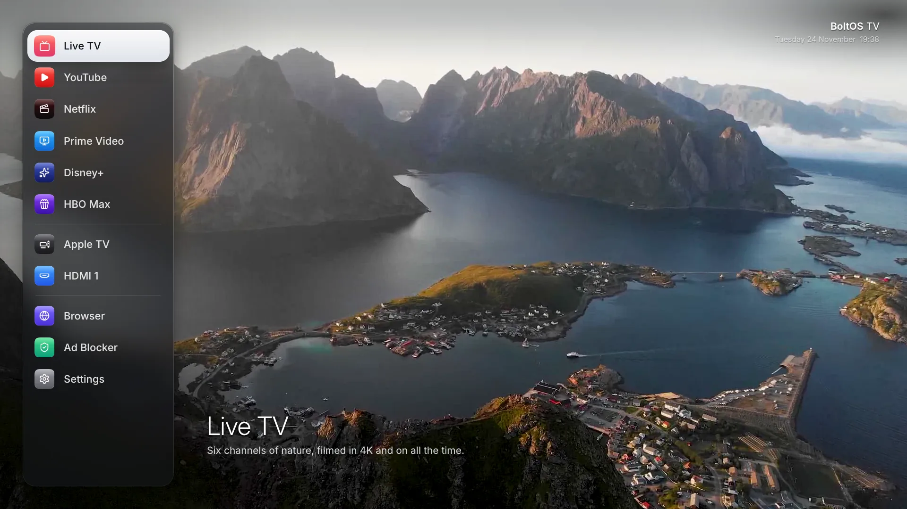

# BoltOS TV

BoltOS TV is a television edition of BoltOS. It uses the same kernel, drivers,
liquid glass and fonts as the desktop, but without the desktop around it. When
you switch it on there is no login and no boot menu. A film fills the screen,
your apps sit in a small glass panel on the left, and the corner shows the
name and the time.

## What is on it

- **Live TV.** Six channels of nature footage, filmed in 4K and playing all
  the time as seamless loops. There's a channel banner, a guide with a still
  of each channel, and you can change channel with up/down or type a number.
- **Apple TV and HDMI 1.** These are input screens, as on any TV, with an input
  switcher along the bottom. (See the limits section below for what they can
  and can't do.)
- **Browser.** A 10-foot web browser. Every page is shown as a reader view:
  one column of large text, with pictures between the paragraphs. You move
  from link to link with the arrow keys, and an on-screen keyboard handles
  addresses and searches. It includes start tiles for Wikipedia, Hacker News,
  NPR, CNN Lite, DuckDuckGo and more, and supports HTTPS (TLS 1.2 and 1.3).
- **Ad Blocker**, built in and on by default. It works on three levels:
  - Every DNS lookup the TV makes is checked against 293 advertising,
    tracking and smart-TV-telemetry networks, including all of their
    subdomains. A blocked name is never contacted, whichever app asked.
  - The browser also skips ad scripts and pictures by URL.
  - Ad slots are removed from every page so the text closes up.
  - The app shows live counters, a "recently blocked" list and a one-press
    self-test.
- **Settings.** Picture (brightness, plus Standard, Vivid, Cinema and Warm
  modes), sound, background film, network status, a sleep timer, the clock and
  time zone, About (credits included), and Restart / Switch off.
- **Ambient mode.** Press Back on Home, or leave the remote alone for 45
  seconds, and everything fades except the film and the clock.
- **Volume overlay and interface sounds.** Volume works from any screen.

## Limits

- **HDMI inputs.** BoltOS TV runs on a small computer plugged into your TV,
  and a computer's HDMI port is an *output*. Nothing in this kernel can
  receive a picture, so the Apple TV and HDMI 1 screens always say "No
  signal" and tell you to use the TV's own Input button. Switching the TV to
  another input automatically would need HDMI-CEC, which PC graphics cards
  almost never expose.
- **Films.** They're filmed in 4K but play at 1080p. They're decoded in
  software as MPEG-1, and 4K would be too much for a CPU on its own. The TV's
  own scaler takes them to 4K. They're silent.
- **Sound** comes out of the computer's own audio output (headphone jack or
  speakers), not over HDMI. Driving HDMI audio is not done yet.
- **Network** is wired Ethernet only (Intel e1000-family and virtio
  adapters). There is no Wi-Fi.
- **Settings are not saved.** BoltOS TV starts with the defaults every time.
  The one exception is Automatic updates, which is kept on the stick.
- **No JavaScript in the browser.** Text-first sites work well; web apps
  don't. YouTube and streaming services won't play.

## Putting it on your TV

You can't install BoltOS TV *inside* a Samsung, LG, Sony or Android TV. Those
sets run their own operating systems on ARM chips with locked bootloaders.
BoltOS TV is an x86-64 operating system, so you install it on a small
computer and connect that computer to the TV with an HDMI cable. The
computer then becomes the TV's "smart" part.

### What you need

- **A 64-bit x86 computer:** a mini PC (Intel NUC, Beelink, Minisforum, an
  Intel N100 box), a small desktop, or an old laptop. 1 GB of RAM is plenty.
- **An HDMI cable** to the TV.
- **A USB stick** of 128 MB or more. It will be erased.
- **A remote or keyboard.** Any USB keyboard works, and so do the cheap 2.4 GHz
  "air mouse" TV remotes that plug in with a USB dongle (they appear as a
  keyboard and mouse). A PS/2 keyboard works too.
- **Ethernet** if you want the browser, the clock from the internet, and
  ad-blocking that has something to block. Live TV works without it.

### 1. Download

Get **`boltostv-usb.img.gz`** (about 37 MB) from
[boltos.dev/tv](https://boltos.dev/tv), or straight from GitHub:

    https://github.com/adriantips/boltossource/raw/main/iso/boltostv-usb.img.gz

### 2. Write it to the USB stick

- **balenaEtcher** (Windows, macOS, Linux): *Flash from file* → choose the
  `.img.gz` (no need to unzip) → choose the stick → *Flash*.
- **Rufus** (Windows): choose the `.img.gz`, and if it asks, pick **DD
  image** mode.
- **macOS terminal:** `diskutil list` to find the stick (say `/dev/disk4`),
  then:

      diskutil unmountDisk /dev/disk4
      gunzip -c boltostv-usb.img.gz | sudo dd of=/dev/rdisk4 bs=4m
      diskutil eject /dev/disk4

- **Linux:** `gunzip -c boltostv-usb.img.gz | sudo dd of=/dev/sdX bs=4M conv=fsync`
  (where `/dev/sdX` is the stick, not your system disk).

The stick boots on both UEFI and legacy BIOS machines.

### 3. Boot it

1. Plug the computer into the TV with HDMI, plug in the stick, the remote
   dongle or keyboard, and Ethernet.
2. Switch the TV to that HDMI input.
3. Power on the computer and open its boot menu. The key is usually **F12**,
   **F11**, **F7**, **Esc** or **F10**, and the logo screen often says which.
   Choose the USB stick.
4. If the machine uses UEFI with **Secure Boot** on, switch Secure Boot off in
   the firmware settings first, because BoltOS TV's loader is not signed by
   Microsoft.

About a second after the firmware hands over, the BoltOS TV logo appears,
then Home, with the first film fading in. The network comes up in the
background a few seconds later.

### 4. Make it feel like part of the TV (optional)

- **Boot from the stick every time:** in the firmware settings, put the USB
  stick first in the boot order and leave it plugged in. A short stick at the
  back of a mini PC is invisible.
- **Turn on with the TV:** many mini PCs have a firmware option called
  **"Restore on AC power loss"** or **"Power on after power failure"**. Set
  it to *Power On* and plug the PC into a switched socket or a TV power
  strip. Then turning the TV's power on boots BoltOS TV as well.
- **Name the input:** most TVs let you rename an HDMI input. Call it
  "BoltOS TV".
- **4K TVs:** BoltOS TV asks the firmware for a 1920×1080 picture and the TV
  scales it to its panel. If the firmware only offers 4K, BoltOS TV draws at
  1080p and doubles every pixel on the way out.

To stop using it, take the stick out. BoltOS TV never writes to the
computer's own disk.

## Trying it without a TV

Download `boltos-tv.iso` (CD image) or build it (see below), then:

    qemu-system-x86_64 -machine q35 -m 2048 -vga std -cdrom boltos-tv.iso \
        -device intel-hda -device hda-duplex \
        -netdev user,id=n0 -device e1000,netdev=n0

**VirtualBox:** create a 64-bit "Other" VM with 1 GB of RAM, attach
`boltos-tv.iso` as the optical drive, set the network adapter to *Intel
PRO/1000*, and start it.

Under emulation without hardware acceleration the films play at a few frames
a second. On real hardware they play at full speed.

## The remote

| Key | What it does |
| --- | --- |
| Arrows | Move |
| Enter / OK | Select |
| Esc / Backspace | Back (on Home: ambient mode) |
| Home, or the Windows key | Home, from anywhere |
| Page Up / Page Down | Channel up / down; page through a web page |
| 0–9 | Tune Live TV directly |
| `+` / `-` / `m` | Volume up, volume down, mute |
| `g` | Guide |
| `i` | Channel banner |
| Any letter in the browser | Start typing an address or a search |

A mouse or air-mouse works everywhere as well: point and click, and use the
wheel to scroll pages.

## Updates

BoltOS TV asks boltos.dev for a newer version once it's online, and every
six hours after; Settings → Updates shows the answer. With Automatic
updates on, a *quick* update found when the TV starts installs and
restarts into itself. A *big* one, or any one with the switch off, waits
for **Update** on that page.

The new kernel goes onto the stick the TV started from, beside the old
one, on the EFI partition, which is why the stick image has room for two.
Both ways of starting switch over (the boot header for legacy BIOS,
`kernel.bin` for UEFI), each with one sector write, after the new kernel
has been read back against its SHA-256. Sticks written before version 1.1
don't have the updater (or the room): write the new image to them once.
The ISO can't be changed, so a TV started from a CD is told to use the
stick.

`bash release.sh tv` publishes one (see `release.sh --help`).

## Building it

BoltOS TV builds on macOS or Linux (and on the Windows/msys2 setup the
desktop uses). The toolchain is nasm, clang, ld.lld, lld-link,
llvm-objcopy and a Python with `pycdlib`. Without Homebrew or root, a
user-local install works:

    curl -sL https://micro.mamba.pm/api/micromamba/osx-arm64/latest | tar -xj bin/micromamba
    ./bin/micromamba create -y -p build/.tools/env -c conda-forge \
        nasm lld llvm-tools clang python=3.12 pip pillow ffmpeg nodejs=22
    build/.tools/env/bin/python -m pip install pycdlib

(Use `linux-64` instead of `osx-arm64` on Linux.) Then:

    bash build-tv.sh

This produces `iso/boltostv.img` (raw disk), `iso/boltos-tv.iso` and
`iso/boltostv-usb.img.gz`. `test/tvvm.py` boots any of them in QEMU, presses
remote keys and takes screenshots. It's what every image in this file came
from.

### Where things are

| | |
| --- | --- |
| `tv/main.c` | `kmain`: the hardware the picture needs, in silence |
| `tv/shell.c` | The loop: input, films, the screen stack, overlays, the panel |
| `tv/home.c`, `live.c`, `inputs.c`, `web.c`, `adblock.c`, `settings.c` | The screens |
| `tv/video.c` | The films, decoded by [pl_mpeg](vendor/pl_mpeg) (MIT) |
| `tv/netsvc.c` | The network thread: DHCP, NTP and every fetch, off the UI thread |
| `tv/stubs.c` | Where shared desktop code reaches for things a TV doesn't have |
| `tv/mkmedia.py` | Cuts the films from their 4K originals as seamless MPEG-1 loops |
| `tv/mkart.py` | Draws the app tiles and the glyphs |

## Credits

Made by **Adrian Derakhshideh**. [boltos.dev](https://boltos.dev) ·
[github.com/adriantips/boltossource](https://github.com/adriantips/boltossource)

The films are from [Pexels](https://www.pexels.com), used under the Pexels
licence:

- *Lofoten Islands* by Clément Proust
- *Turquoise Coast* by Kenan Turguç
- *Sundown at Sea* by Oskar Gross
- *Northern Lights* by T Honkamies
- *Kauai Coastline* by Logan Voss
- *Autumn Forest* by AP Vibes

MPEG-1 decoding is [pl_mpeg](https://github.com/phoboslab/pl_mpeg) by Dominic
Szablewski (MIT). The type is Inter, and the icons are
[Lucide](https://lucide.dev) (ISC).
