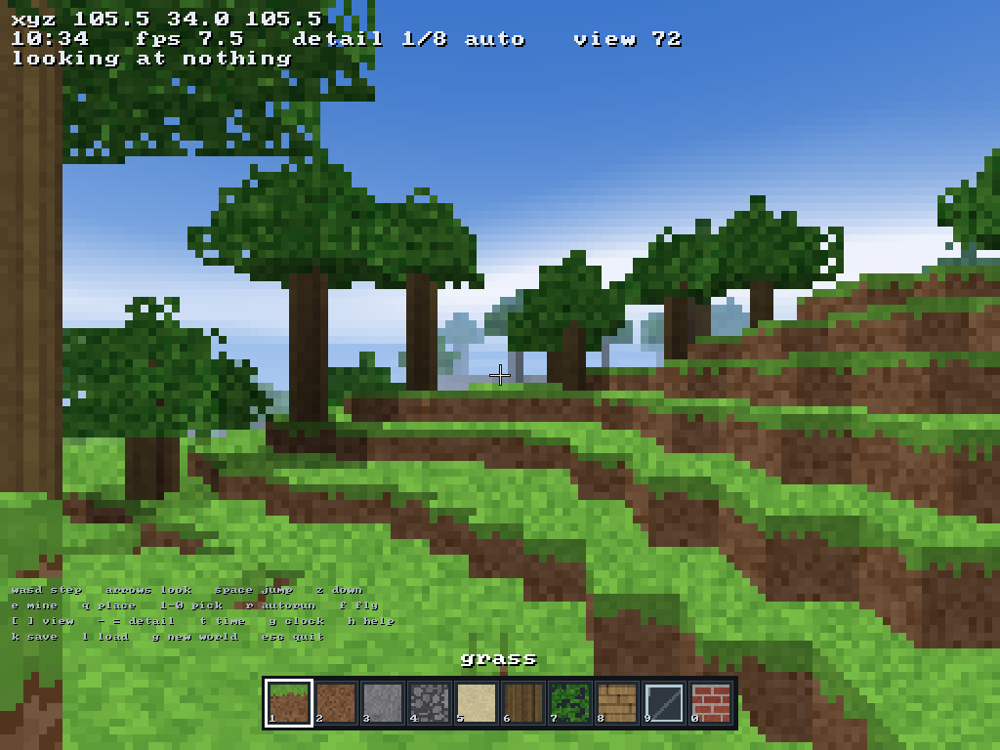

# boltcraft

A voxel sandbox for BoltOS. Dig, build, swim, get lost in a cave, watch the
sun go down. 256x256x64 blocks, no chunk loader, no GPU, about 90 KiB.



It is a third-party program in the strict sense: it is built with `sdk/bolt`
against the published headers, it talks to the kernel only through the eleven
syscalls in [SDK.md](../SDK.md), and the kernel links not one line of it.

---

## Playing it

It ships in the image. There is an icon on the desktop -- a grass block -- and
clicking Play on it runs `/bin/boltcraft`, which takes the panel for as long as
you are in there and hands it back on escape. From a prompt it is

```
run boltcraft
run boltcraft -seed 1234        # a named world instead of the default one
```

The launcher is `kernel/app_boltcraft.c` and it is about a hundred lines of
window with a `proc_exec` at the bottom; it would launch anything else in
`/bin` just as well, which is the honest measure of how much the kernel knows
about voxels.

**It did not always.** For a while the only way to play it was to run an HTTP
server on another machine and type a `download` line, because nothing built it
into the image, nothing seeded `/bin/boltcraft`, and there was no icon. And the
build line below did not work either: `sdk/build.sh` was not linking
`kernel/font8x8.c`, which `hud.c` needs for every character it draws, so the
build the paragraph after this one tells you to run died on an undefined
`font8x8_basic`. The PowerShell half of the SDK had the file and the bash half
did not. `test/t_boltcraft.py` is one assertion per mistake.

---

## Building it yourself

```
sdk\bolt build boltcraft
sdk\bolt ship  boltcraft
```

and then, on the other machine, what `ship` prints:

```
download http://10.0.2.2:8420/boltcraft /bin/boltcraft
chmod 755 /bin/boltcraft
run boltcraft
```

From bash rather than Windows:

```sh
sdk/build.sh -o boltcraft boltcraft/main.c boltcraft/world.c \
             boltcraft/tex.c boltcraft/render.c boltcraft/hud.c
```

`build.sh` compiles the same five files with the same flags at step 2b3 and
embeds the ELF, so the copy in the image and the copy the SDK produces are the
same program.

---

## Controls

| | |
| --- | --- |
| `W` `A` `S` `D` | step / strafe |
| arrow keys | look |
| `space` | jump, or rise when flying |
| `Z` | sink when flying |
| `F` | flight on/off |
| `R` | autorun on/off |
| `E` | break the block under the crosshair |
| `Q` | place the selected block against it |
| `1`..`9`, `0` | pick from the bar |
| `[` `]` | view distance |
| `-` `=` | detail, coarser / finer |
| `T` | push the clock forward |
| `Y` | stop and start the clock |
| `H` | hide the key list |
| `K` `L` | save and load `/home/user/boltcraft.wld` |
| `G` | throw the world away and make another |
| `esc` | quit, and give the screen back |

**Why movement is taps and not holds.** `SYS_GETKEY` returns characters. There
is no key-up event, no way to ask whether W is still down, and the xHCI HID
path drops a scancode that was already pressed in the previous report
(`drivers/xhci.c`), so holding a key produces exactly one event. Every step is
therefore an impulse into a velocity that eases out over about a fifth of a
second: one tap is one stride, tapping is running, and `R` latches it for when
you want to cross the map. On a keyboard that does repeat, the same model is
ordinary smooth WASD and you will not notice any of this.

---

## What is out there

Four octaves of value noise for the ground, with a gated ridge term so there
are a few real mountains rather than uniform lumpiness. Sea level at y=26;
sand where the land meets it, snow above about y=41, oak trees on the grass in
between. A hundred and ten cave worms are cut through the rock afterwards,
with coal ore in clumps below y=34 for something to find down there. Bedrock on
the floor, and it does not break.

The noise lattice wraps at 256 and so does the block index, so walking east
long enough brings you back where you started and no ray ever reaches an edge.
That is the whole of the chunk system: there isn't one, and the 4 MiB is
allocated once at startup.

---

## How it draws

One DDA per pixel — Amanatides and Woo — at a fraction of the panel
resolution, upscaled, with the HUD drawn afterwards at full resolution so the
text stays sharp however coarse the 3D is.

The ray does not stop at the first block it meets. Leaves have real holes in
their texture and glass is mostly hole, so a sample with alpha composites and
the ray carries on; you can see sky through a canopy and a room through a
window. Water is the exception: it is treated as a volume, with one surface
reflection and then absorption by path length, because compositing every face
of a twelve-deep ocean turns it to ink.

Every texture is generated at startup — cobble is a jittered Voronoi, log ends
are rings, glass is a frame around nothing. None of it is in the binary, which
is why there is room for it.

**Speed.** The detail setting picks itself. On real hardware, or in a VM with
virtualisation switched on, it settles around 1/2 or 1/3 and runs at 40-60 fps.
Under QEMU's interpreter — which is what `run.bat` gives you, with no `-accel`
flag — it settles at 1/6 to 1/8 and gets 10-15, and that is a floor it cannot get
under: `SYS_FBPRESENT` copies all 786,432 pixels of the panel however few of
them you computed, and that copy alone is most of the frame. `-` and `=`
override the chooser if you disagree with it.

---

## Knowing what time it is

There is no clock syscall, and physics without a real `dt` is physics that runs
at a different speed on every machine. `rdtsc` works from ring 3 (`CR4.TSD` is
never set) but says nothing about its own rate, and `CPUID` leaves 0x15, 0x16
and the hypervisor leaf all answer zero under emulation — which is exactly
where it matters, because a frame chooser with no clock cannot tell 1 fps from
60 and sits at the wrong detail insisting everything is fine.

So the fallback measures it: `SYS_ACCEPT`'s timeout is counted in PIT ticks by
`net/tcp.c`, so an accept on a port nobody will connect to is a sleep of a
known length. Two of them, 120 ms and 420 ms, and the difference gives the
counter's rate without the call's own overhead. It costs half a second of
startup, needs no network traffic, and is accurate to about a percent — it
reads 4.1-4.5 GHz on this machine under QEMU, which is the host's true clock.

---

## The files

| | |
| --- | --- |
| `craft.h` | block ids, the world index, the small inlines the ray loop wants |
| `world.c` | terrain, caves, trees, spawn, and the run-length save format |
| `tex.c` | every texture, all sixteen pixels square and all tileable |
| `render.c` | the raycaster, the sky, and the upscale |
| `hud.c` | crosshair, text, hotbar tiles |
| `main.c` | the loop: input, physics, the clock, and what to draw on top |

Two of these lean on the platform in ways worth knowing about if you move the
code: `libc`'s `memset` and `memcpy` are byte loops (`libc/string.c`), which
costs four million single-byte stores to clear the world and two megabytes of
them per frame to duplicate rows in the upscale, so both use `rep stos`/`movs`
directly instead. That is not premature — it was a third of the frame.
