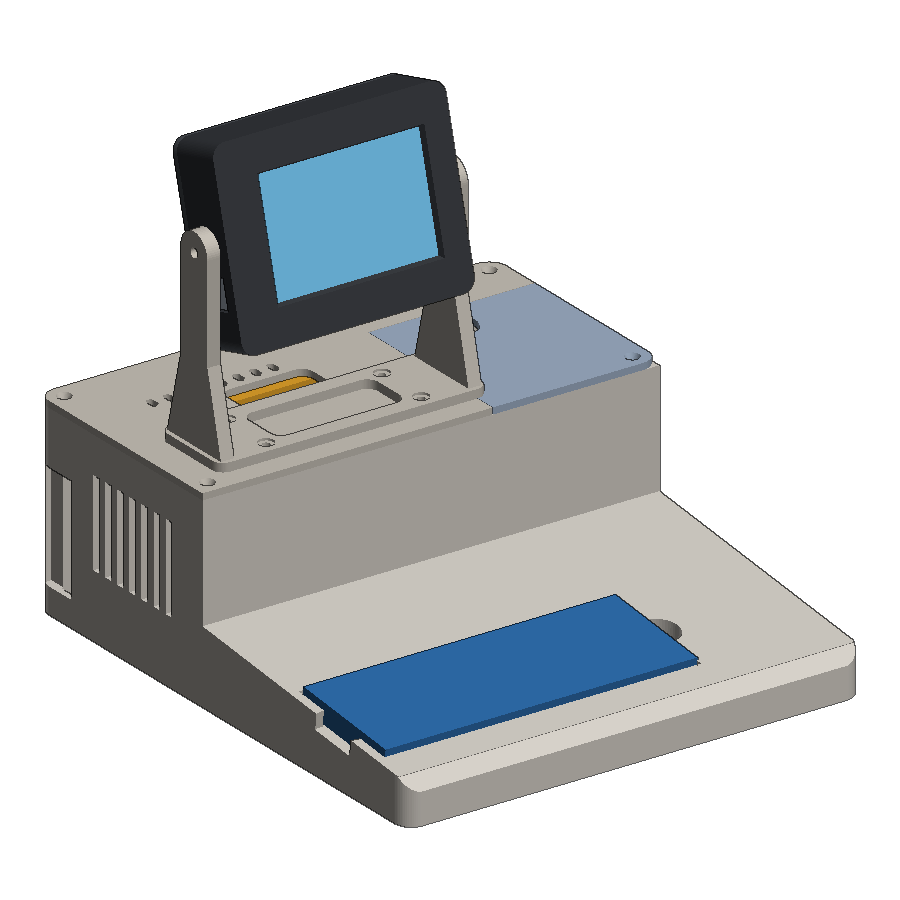
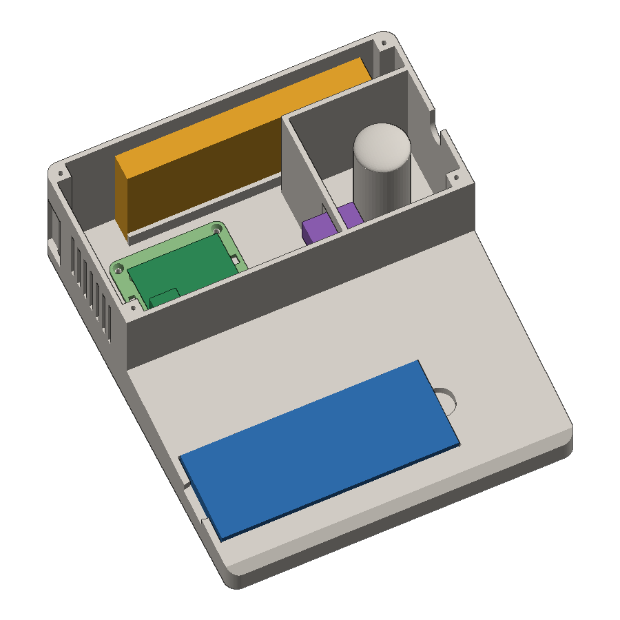

# BoltOS Mini desk case

A desk computer case for the Orange Pi Zero3. It is about 212 × 245 × 219 mm (8.4 × 9.6 × 8.6 in).

- **Front:** the mini keyboard (touchpad included) sits in a tilted pocket. Finger scoops on both sides let you lift it out.
- **Right side of the deck:** the 4-port USB hub's ports are exposed. The hub drops in from underneath and is held by a screwed cover.
- **Tower:**
  - The Pi sits on a sled at the front left.
  - The power bank stands on its long edge against the back wall. A window in the left wall at its port end lets you plug in a charging cable.
  - The Ethernet cable well is at the front right. Inside it are a keystone RJ45 jack and a post to wrap the cable around. The cable runs out through a slot in the right wall, and the well has its own lift-off lid.
- **Screen:** the 3.5" LCD sits in a pod on a two-arm mast, centred over the keyboard and about 175 mm above the desk. It tilts on two M4 screws. Tighten them to hold the angle you want.




## Files

`stl/` has one file per printed part, already in print orientation. None of them need supports, and each fits a 220 × 220 bed.

| part | print |
|---|---|
| `tower.stl` | upright |
| `deck.stl` | upright, flat bottom down |
| `lid.stl` | top face down |
| `well_lid.stl` | top face down |
| `hub_cover.stl` | flat |
| `pi_sled.stl` | flat |
| `mast.stl` | upright |
| `screen_bezel.stl` | screen face down |
| `screen_back.stl` | outside face down |

`_assembled_preview.stl` is the whole thing put together. It's only for looking at, not for printing.

Suggested settings: PETG or PLA, 0.2 mm layers, 3 walls, 15–20 % infill. The tower and the deck are the long prints.

## Sizes it is built for

- keyboard 145 × 55 × <10 mm (pocket made for 9.5 mm), power bank 150 × 70 mm, USB hub 105 × 47.5 mm (your measurements)
- **assumed, not measured:** power bank 16 mm thick, hub 13 mm tall, hub ports along its long side
- LCD: LCDwiki **MPI3508** 3.5" HDMI, from its official outline drawing. The glass is 85.51 × 56 mm, the active area 73.44 × 48.96 mm, the PCB 75 × 60.6 mm, and it's 20.86 mm deep to the back of the pin header. In the pod it sits in landscape: the HDMI socket points down out of the slot in the pod's bottom, and the micro-USB power port comes out of a notch in the pod's left side. Power the LCD through that micro-USB from the power bank. If the picture comes out upside down, rotate it 180° in software.

To change any size, edit the **Your parts** block at the top of `case.py` and rebuild:

```bash
pip install manifold3d numpy pillow
```

```bash
python3 case.py
```

It rewrites the STLs and the previews, then checks that nothing collides. If the keyboard or hub is bigger than the defaults, the case grows to fit. Check the part sizes it prints against your print bed.

Things I couldn't confirm from datasheets:

- **Orange Pi Zero3 mounting holes:** `PI_HOLES` is a guess. The board sits on its own small sled, so if the holes don't line up, only reprint `pi_sled.stl` (it takes about 15 minutes).
- **LCD clamping:** the LCD is clamped between the bezel and the back cover, so its own mounting holes don't matter. The cover presses on the bare top and bottom edges of the PCB and on the back of the glass past the PCB's end. If anything rattles, a small piece of foam tape behind it fixes that.

## Hardware

- 1 keystone RJ45 coupler (female–female), plus a 15–25 cm Cat6 patch cable from the coupler to the Pi
- micro-HDMI → HDMI cable. A thin one with a 90° HDMI end, or a flat FPC ribbon kit, routes much better.
- micro-USB cable to power the LCD
- short USB-C cable (power bank → Pi). The power bank needs two outputs.
- M3 screws, driven straight into 2.6 mm pilot holes (no inserts needed):
  - lid: 3 × M3×10 countersunk, plus 1 more if you want the well lid screwed down
  - deck → tower: 3 × M3×12, put in from inside the tower
  - mast → lid: 4 × M3×10 with nuts under the lid
  - screen back cover: 4 × M3×10 countersunk
  - Pi sled: 4 × M3×8 countersunk
  - hub cover: 4 × M3×6 countersunk
- 2 × M4×12 pivot screws (they thread into the screen pod)
- 4 × M2.5×6 for the Pi
- 8 × 12 mm stick-on rubber feet. The recesses are on the bottom.

## Assembly

1. Screw the deck to the tower with 3 screws from inside the tower.
2. Put the hub in its bay from underneath, with the ports against the right-side window. Run its cable along the groove under the deck and into the tower, then screw on the hub cover.
3. Snap the keystone coupler into the wall between the Pi bay and the well. Mount the Pi on the sled, screw the sled to the floor, and connect the patch cable from the Pi's Ethernet port to the coupler.
4. Stand the power bank against the back wall with its ports facing left. Connect the Pi's USB-C cable and the LCD power cable.
5. Clamp the LCD into the bezel with the back cover. Bring HDMI and power out of the slot at the bottom of the pod.
6. Bolt the mast to the lid, pass the cables up through the slot behind the mast, put the lid on, and fit the screen pod between the arms with the M4 screws.
7. **Ethernet:** plug your cable into the coupler inside the well, wrap it around the post, and lead the free end out of the slot in the right wall. Put the well lid on. To use it, lift the lid, unwrap as much cable as you need, and pull it out through the slot.
